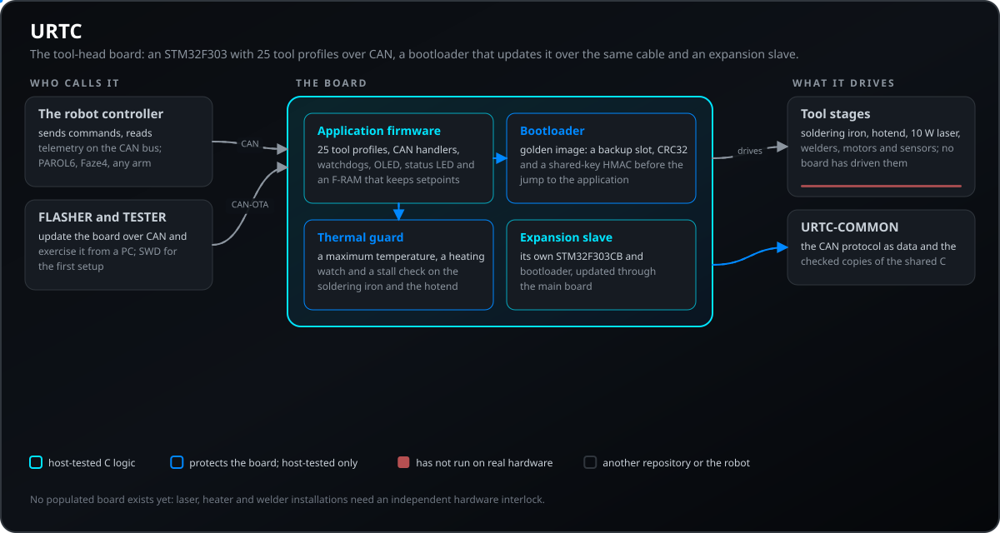
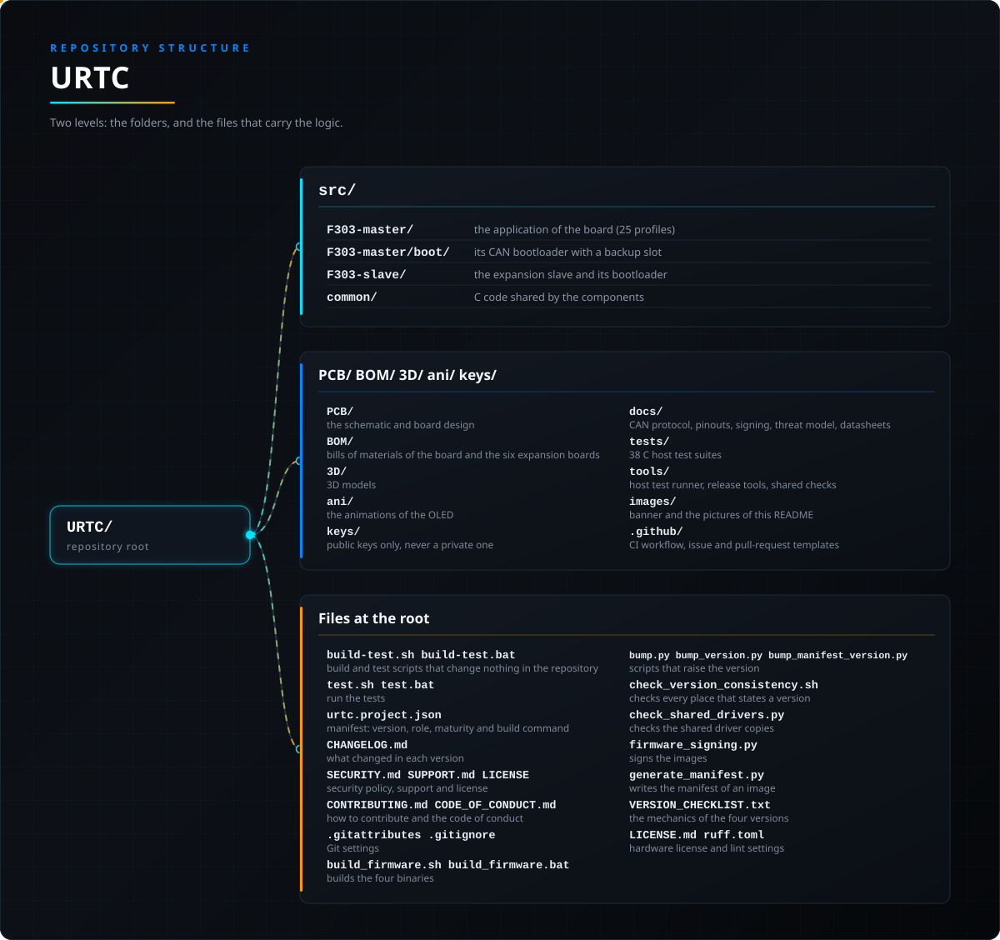

<p align="center">
  
</p>

# 🚀 URTC — Universal Robot Tool Controller

<p align="center">
  🇺🇸 <b>English</b> |
  <a href="README_spa.md">🇪🇸 Español</a> |
  <a href="README_fra.md">🇫🇷 Français</a> |
  <a href="README_ita.md">🇮🇹 Italiano</a> |
  <a href="README_deu.md">🇩🇪 Deutsch</a> |
  <a href="README_zho.md">🇨🇳 简体中文</a> |
  <a href="README_jpn.md">🇯🇵 日本語</a> |
  <a href="README_por.md">🇵🇹 Português</a>
</p>

### The tool-head controller of a robot arm: an STM32F303 board with 25 tool profiles over CAN, a CAN bootloader and an expansion slave

<p align="center">
  
  
  
  
  
  
</p>

---

**Status: 🚧 Actively evolving project — releases exist, but nothing has run on a real board.** Tagged releases (v0.3.x) exist, each with the firmware images built from this source, but no populated board exists, so the firmware has never run on a real board. URTC is under continuous, active development on both fronts at once: firmware (new tool profiles, the expansion slave ecosystem, protocol changes) and hardware (schematic and BOM still being finalized, no populated board exists yet). Because both sides keep moving together, what's in this repository at any given moment is a snapshot of ongoing work, not a stable, versioned product — file names, folder structure, tool counts, and documentation can all still change as the design settles. Once both firmware and hardware reach a genuinely stable, verified-on-real-hardware state, a proper **Release** will be tagged bundling everything together (firmware, bootloader, PC tools, hardware design files, and documentation) as a coherent, frozen snapshot. Until then, treat `main` as the actively-moving target it is.

---

> **⚠️ Safety notice (design stage, no board has run this firmware yet):** this board drives a **10W engraving laser diode** and multiple heater stages (T12 soldering iron cartridge, 3D printer hotend). Building and using it means working with equipment that can cause **burns, fire, or eye damage** if assembled or operated without proper safety measures (laser goggles rated for the diode's wavelength, thermal protection, an accessible power cutoff). This is a hobbyist/maker project shared as-is — build and use at your own risk, and don't skip basic safety practice just because the firmware has watchdogs (software watchdogs that have never run on a real board).

> **Safety and security status:** this ecosystem is not a certified safety system, and no populated URTC board exists yet. The bootloaders check firmware images with CRC32 and a shared-key HMAC-SHA256, not with an asymmetric signature (planned); the published application images are signed with the public development key (`signing_key_kind: dev`), so anyone can produce an image the bootloader accepts; nothing has been transmitted to a real board. Read the [security baseline](https://github.com/JuanenRac/URTC-DOCS/blob/main/docs/SECURITY_BASELINE.md) and the [threat model](https://github.com/JuanenRac/URTC-DOCS/blob/main/docs/THREAT_MODEL.md) before relying on any statement here for the safety of a person.

## 📋 At a glance

| | |
|---|---|
| Version | `0.4.2` |
| Maturity | Functional |
| Stack | STM32F303 / bxCAN / 25 tool profiles |
| Target | A microcontroller board (the firmware); built on a PC |
| On real hardware | Not yet: no run on real hardware is recorded for this version |

**Jump to:** [Overview](#-overview) · [Architecture](#-architecture) · [Features](#-features) · [Security](#-security--safety) · [Interfaces](#-interfaces) · [Quick start](#-quick-start) · [Testing](#-testing) · [Structure](#-repository-structure) · [Related](#-related-projects)

<!-- urtc-section:status_firmware -->
## 🚦 Project status

🟢 done and verified · 🟡 works, with known limits · 🟠 half done or not verified · 🔴 not done or not working. Nothing is green if it never ran on real hardware.

| Part | Status | What the repository can show |
| --- | :---: | --- |
| Software | 🟡 | Builds and passes the tests on a PC; the run on a real tool head is still pending. |
| Tests | 🟢 | The test suite passes in the CI on every push. |
| Real hardware | 🟠 | No run on a real board yet: the bench test is still pending. |
| Security | 🟡 | Releases are signed with Ed25519 and checked before use; the key handling was not reviewed by anyone else. |
| Documentation | 🟡 | README in eight languages and reference documents; the translations were not reviewed by native speakers. |

<!-- /urtc-section:status_firmware -->

## 🎯 Overview

Hi everyone! I wanted to share a project I've been developing called URTC (Universal Robot Tool Controller). It is a monolithic, highly integrated control board designed specifically to expand the capabilities of robotic arms and automation setups, making it a perfect match for platforms like PAROL6 and Faze4 — two open-source robotic arms designed and developed by [Source-Robotics](https://source-robotics.com/) ([GitHub](https://github.com/Source-Robotics)).

**URTC is an independent, unofficial project.** It isn't developed or endorsed by Source-Robotics — it's a compatible tool-head controller built to work well with PAROL6 and Faze4, and the same CAN-based architecture is open to adapting for other robotic arm platforms too.

Here is the complete breakdown of what it is, what it does, and the hardware ecosystem it currently manages.

URTC is an all-in-one, compact control board powered by an STM32 microcontroller (STM32F303CCT6, LQFP48). It communicates with the main robot controller via CAN bus, intended for low-latency execution of complex tasks right at the tool head or axis (latency has never been measured on a board, and no hard real-time guarantee is made). It features an onboard OLED display for instant diagnostics — animated boot splash, per-tool animated icons, live telemetry on a two-tone panel — a single-pixel RGB status LED plus an addressable RGB LED ring for camera illumination, a 20-pin expansion connector for add-on boards, an onboard F-RAM that persists the active tool's setpoints across a power loss, and dedicated analog and high-current power stages.

## 🧩 Role in URTC

URTC is the board and its firmware: the part of the ecosystem that sits on the robot's tool head and does the work, with a CAN bootloader that lets the application be updated over the same cable. Everything else in the family is built around it. URTC-COMMON writes its CAN protocol once as data, URTC-FLASHER and URTC-TESTER update and exercise it from a PC (URTC-WEB-STUDIO does both in a browser), URTC-GATEWAY can stand in front of its bus, URTC-SMART-RACK stores the heads, URTC-VISION-TOOL is a head that inspects, URTC-UPDATER keeps the programs current and URTC-DOCS holds the architecture and what is proven. It is meant for robot arms such as PAROL6 and Faze4 and is an independent, unofficial project. No populated board exists yet.

## 🏛️ Architecture

<p align="center">
  
</p>

How the parts of this repository fit together: who uses it, what it holds and what it depends on. The picture is drawn from `docs/architecture.json` and checked against the code.

### Scalable Architecture & Tool Matrix

The core strength of URTC is its extreme versatility. Instead of swapping out electronics for every different job, the board features a scalable matrix architecture:

* **32-Address Identification Scheme:** the hardware and communication protocol are designed to identify up to 32 different tools or end-effectors directly at the robot head, via a 5-bit solder-jumper ID matrix (ID0-ID4). Of those 32 readings, 31 map directly to a tool profile; the 32nd (all 5 jumpers installed, `11111`) is reserved as a "free configuration" address instead - see below.
* **25 Plug-and-Play Automated Profiles:** the firmware natively handles 25 tool profiles - the board reads the physical identity of the tool head and configures the power stages, sensors, and logic switching seamlessly without needing a full re-flash. 6 more addresses remain free within the existing scheme for future tool profiles.
* **Free tool configuration:** the reserved `11111` jumper reading doesn't pick a fixed tool - it tells the board to look up which tool to use from a register in its own persistent F-RAM instead, set ahead of time over CAN (via `URTC Flasher`). Useful for a board that needs reprogramming to a different tool without physically re-soldering jumpers. See `docs/EEPROM.TXT` section 5 for the full mechanism.

### Flash memory layout (256K total, golden-image / A-B update model)

```
0x08000000 ┌─────────────────────────────────┐
           │  Bootloader (30K)                 │  Always runs first on every boot.
           │                                   │  Listens briefly on CAN, then either
           │                                   │  jumps to the app or waits for an
           │                                   │  update. Drives the OLED directly
           │                                   │  during an update (see below).
0x08007800 ├─────────────────────────────────┤
           │  Metadata page (2K)               │  Describes whatever's in the main
           │                                   │  slot right now: HardwareID,
           │                                   │  version, size, CRC32, and an
           │                                   │  HMAC-SHA256 signature. The
           │                                   │  bootloader checks all of it
           │                                   │  before ever jumping to the app.
0x08008000 ├─────────────────────────────────┤
           │  Main slot (112K)                 │  This is the application firmware /
           │                                   │  URTC_MAIN_FIRMWARE_v<version>.* — the actual
           │                                   │  firmware that runs day to day,
           │                                   │  described everywhere else in
           │                                   │  this README. Never touched by
           │                                   │  an update until a verified,
           │                                   │  known-good image is ready to
           │                                   │  replace it.
0x08024000 ├─────────────────────────────────┤
           │  Backup / staging slot (112K)     │  Raw storage only, never
           │                                   │  directly executed. Every CAN
           │                                   │  update writes here first.
0x08040000 └─────────────────────────────────┘
```

**Why a backup slot.** A CAN update is never written into the slot that's currently running. It goes into backup first, gets fully verified there — size, CRC32, and an HMAC-SHA256 check against a shared symmetric key, showing it was made by someone holding that key (the published images use the public development key), not just that it arrived intact — and only then gets copied into the main slot. A power loss at any point before that copy starts leaves the currently running firmware completely untouched, so there's no window where an interrupted download can brick the board. If the power loss happens *during* the copy itself, the bootloader notices on the next boot (backup, never touched during the copy, is still fully intact) and simply resumes copying from it until it succeeds.

## 🖼️ Screenshots


*(Work in progress — more angles and a populated board coming soon.)*

## ✨ Features

### Hardware Flexibility & Motor Support

To handle such a wide variety of applications, the URTC hardware is fully equipped to control:

* **NEMA Stepper Motors:** NEMA 8, 11, 14, and 17 run directly off the onboard TMC2209, same as NEMA 23 and 34 — up to **2.0A** on any of them via the main board's driver stage. For NEMA 23/34 at their full rated torque, a TMC5160 on the expansion connector (see below) supports up to **10A**, current-scaled by the external MOSFETs/sense resistor chosen for that board — the onboard 2.0A limit doesn't apply once a motor's moved to the expansion driver.
* **3-Phase BLDC / Gimbal Motors** for high-precision movement.
* **Motors with Hall sensors and tachometers** for closed-loop control.
* **Dedicated inputs** for reflective optical proximity sensors like the TCRT5000, plus a generic active-low endstop/limit-switch input shared across four tool profiles.

### Expansion Connector

A 20-pin header, separate from the tool-specific connectors, for add-on boards that need more than what a given tool profile alone exposes — an extra stepper axis (TMC2209 or TMC5160), a second sensor board, that kind of thing.

| Pins | Signal |
|---|---|
| 4 | 24V |
| 1 | 3.3V |
| 1 | 5V |
| 3 | GND |
| 2 | Bit-banged I2C (SCL/SDA) — its own bus, separate from the OLED/F-RAM's hardware I2C2 |
| 3 | STEP/DIR/EN — universal to either driver chip below |
| 4 | Bit-banged SPI (CS/SCK/MISO/MOSI) — for a TMC5160's configuration/diagnostics interface, or any other SPI-configurable chip |
| 1 | General-purpose GPIO (EXTI-capable interrupt input if a future add-on needs a fast sensor response, e.g. an endstop) |
| 1 | TMC5160 DIAG0 (stall/fault diagnostic line, polled via `0x182`/`0x183`) |

20 pins total.

**Two separate I2C buses on purpose:** the OLED/F-RAM use this chip's one usable hardware I2C peripheral (I2C2, on PA9/PA10); the expansion connector gets its own, independent bit-banged I2C bus (PB10/PB11 - this chip's only other I2C-capable pin pairs were already committed to other functions, so bit-banging was the way to give this connector its own bus without a hardware conflict). Anything hanging off the expansion header — an I2C ADC/DAC, a port expander, whatever a given add-on board needs — shares this bit-banged bus with any other expansion-side I2C device, but can't stretch the clock or otherwise interfere with the OLED's own timing on its separate, hardware I2C2 bus.

**A TMC2209 or a TMC5160, not necessarily both.** Both chips use the same STEP/DIR/EN interface for actual motion, so that part is universal. Where they differ is configuration/diagnostics: a TMC2209 uses its own single-wire UART for that, while a TMC5160 uses SPI — and since the two are mutually exclusive on any given expansion board, the 4 SPI pins double as a natural home for a TMC2209's single UART line too, rather than needing yet another dedicated pin nobody uses at the same time as the SPI bus. The bit-banged SPI bus talks the exact protocol a TMC5160 expects (SPI Mode 3, MSB first, CS held low for the whole transaction — see `docs/CANBUS.TXT`'s `0x180`/`0x181` for the generic byte-passthrough command that drives it) rather than this firmware needing to know that chip's specific register layout. A TMC5160's DIAG0 stall/fault line is wired too (`0x182`/`0x183`) — it reuses one of the two general-purpose GPIO pins, which were already earmarked for exactly this kind of fast interrupt-driven input.

Full pin-by-pin detail — which MCU pin backs which signal, and the reasoning behind a couple of layout constraints this chip's 48-pin package has — lives in `docs/PINOUT_CONNECTORS.TXT` and `src/F303-master/README.md`.

#### The 6 expansion board variants

4 of the 6 expansion board variants carry a stepper driver — either a TMC2209 (up to 2A/coil, integrated power MOSFETs) or a TMC5160A (up to 10A+/coil, needs 8 external power MOSFETs the driver itself doesn't include). Independent of that driver choice, a driver-carrying board is either **basic** (driver + connectors only, no MCU — STEP/DIR/EN routed straight from the main board) or **advanced** (adds a second microcontroller, STM32F303CBT6, plus 2 local sensor chips — an ADS1115 16-bit ADC and an MLX9064x-family thermal camera — and local PWM generation for tools whose timing needs generating right at the tool head rather than routed over a cable). 2×2 combinations, plus 2 more sensor-only basic boards (ADS1115 or MLX9064x, wired directly to the main board's own STM32F303CC, no driver and no slave MCU) for a tool that only needs one of those 2 chips and nothing else an advanced board also carries — 6 boards total — see `BOM/BOM_EXPANSION_*.TXT` (6 files), `docs/EXPANSION.TXT`, and `docs/PINOUT_SLAVE.txt`.

The advanced variant's own STM32F303CBT6 talks to the main board over the expansion connector's existing bit-banged I2C bus above — main board as master, slave chip answering as a real hardware I2C slave — and drives its own second, local-only I2C bus for the 2 sensor chips. It has its own bootloader and application firmware, updated the same way the main board is (CAN-OTA from `URTC Flasher`), just relayed across that I2C link rather than reaching the slave chip directly. See `src/F303-slave/README.md` and `src/F303-slave/boot/README.md` for the full technical detail.

### Parameter Persistence

An onboard FM24CL64B F-RAM (64Kbit, I2C) keeps a periodically-updated snapshot of the active tool's setpoints and the global LED/OLED settings, so a sudden power loss doesn't leave "what was this board doing" as unknowable as the loss itself was unplanned. It shares the OLED's hardware I2C2 bus rather than getting one of its own — this MCU only has one usable hardware I2C peripheral for this purpose, already spoken for by the OLED (see `src/F303-master/README.md` section 6 for the full reasoning).

**Recovered state is queryable, never auto-applied to anything hazardous.** On boot, whatever was saved becomes readable over CAN (`0x190`/`0x191`) — but a heater setpoint, laser power, or motor command is never silently re-armed on its own. Only the safe, passive settings (LED colors, OLED mode) get restored directly. Deliberately re-sending a setpoint after actually reviewing what happened is left as the master controller's call, not something this board decides by itself the instant power comes back.

### Natively Automated Tool Catalog (25 Firmware Profiles)

Through its dynamic switching logic, the firmware natively manages the following tool heads:

1. **Soldering Station (T12):** temperature control with hysteresis (on/off, not PID) using direct ADC feedback to handle standard T12 soldering tips, plus a motorized wire feeder spooling solder wire into the joint (shares `CONN_MOT` and its stepper protocol with the plain-motion tools below - trades away this tool's own generic endstop input to make room for it). [Jumper/wiring config →](images/TOOL_SOLDERING_IRON.png)
2. **SMT Solder Paste Dispenser:** millimetric feed control for precise solder paste deposition on PCBs. [Jumper/wiring config →](images/TOOL_PASTE_DISPENSER.png)
3. **Thermal Paste / Liquid Dispenser:** fluidity management for high-viscosity pastes or liquid adhesives. [Jumper/wiring config →](images/TOOL_LIQUID_DISPENSER.png)
4. **Smart Electric Screwdriver:** rotation and stop control through the stepper interface. Planned: stopping on torque limits (no torque sensing exists yet). [Jumper/wiring config →](images/TOOL_SCREWDRIVER.png)
5. **Vacuum / Pneumatic Gripper:** vacuum pump control and pressure level reading for safe Pick-and-Place operations. [Jumper/wiring config →](images/TOOL_VACUUM_PICKUP.png)
6. **Drill (BL4260):** PWM speed control, direction switching, and dynamic electric braking with live RPM readings, on its own dedicated enable/brake line, independent from the stepper-tool driver enable. Generic endstop input available. [Jumper/wiring config →](images/TOOL_DRILL.png)
7. **Gimbal Gripper:** high-sensitivity manipulation using 3-phase brushless gimbal motors. [Jumper/wiring config →](images/TOOL_GRIPPER_GIMBAL.png)
8. **NEMA Gripper:** robust clamping force controlled via a heavy-duty stepper motor. [Jumper/wiring config →](images/TOOL_GRIPPER_NEMA.png)
9. **AOI (Automated Optical Inspection) System:** synchronous stroboscopic control of the LED lighting array for machine vision camera capture. Generic endstop input available. [Jumper/wiring config →](images/TOOL_AOI_INSPECTION.png)
10. **Engraving Laser Diode (10W optical):** PWM beam power modulation with a CAN watchdog in software that locks the laser output down if host communication is lost (built, never run on a real board, and no substitute for an independent hardware interlock). Generic endstop input available. [Jumper/wiring config →](images/TOOL_LASER_ENGRAVER.png)
11. **3D Printing Hotend:** On/off control with hysteresis of the heater cartridge, NTC thermistor reading, extruder control, and a dedicated 25kHz PWM-controlled layer cooling fan (4-wire, tachometer feedback, own communication watchdog) — all integrated into a single block. [Jumper/wiring config →](images/TOOL_3D_PRINTER.png)
12. **3D Scanner Probe:** ultra-fast hardware interrupt input (EXTI) with absolute priority for real-time surface digitization and impact sensing without lag. Also covers metrology touch probing - the same hardware path, a different physical probe on the same tool head. [Jumper/wiring config →](images/TOOL_SCAN_PROBE.png)
13. **SMT Pick & Place Head:** rotary A-axis for correct pad alignment, on the same stepper interface as the paste/liquid dispensers and both grippers above. [Jumper/wiring config →](images/TOOL_SMT_PICKPLACE.png)
14. **Heavy-Duty Electromagnet:** on/off pickup control for ferromagnetic parts, off the T12 heater output repurposed as a generic GPIO driver. [Jumper/wiring config →](images/TOOL_ELECTROMAGNET.png)
15. **Spot Welder Head:** millisecond-precise weld pulses for battery-pack nickel strips, with a surface-contact sensor gating the pulse. [Jumper/wiring config →](images/TOOL_SPOT_WELDER.png)
16. **Conformal Coating Airbrush:** protective coating spray control for finished PCBs - the spray valve and its own sensor live on the robot's own mainboard, outside this board's own scope. [Jumper/wiring config →](images/TOOL_CONFORMAL_COATING.png)
17. **Large-Format Vacuum Gripper:** multi-cup suction array for unpopulated FR4 boards, on the same stepper interface as tool #13 above. [Jumper/wiring config →](images/TOOL_VACUUM_GRIPPER_LG.png)
18. **Functional Testing Head:** flying-probe voltage/continuity testing — basic reading off the onboard ADC, advanced reading via an ADS1115 16-bit ADC on an **advanced** expansion board. [Jumper/wiring config →](images/TOOL_FLYING_PROBE.png)
19. **UV Curing Head:** high-power UV LED driver for instant glue/mask curing. [Jumper/wiring config →](images/TOOL_UV_CURING.png)
20. **Hot Air Rework Nozzle:** heating element, turbine blower, and thermocouple feedback for reflowing misaligned SMD parts - shares the soldering iron's own thermal control loop. [Jumper/wiring config →](images/TOOL_HOTAIR_REWORK.png)
21. **Pneumatic Press-Fit Inserter:** linear actuator control for pressing connectors into PCBs - the actuator and its own sensor live on the robot's own mainboard, outside this board's own scope. [Jumper/wiring config →](images/TOOL_PRESSFIT_INSERTER.png)
22. **Wire Harnessing / Crimping Actuator:** high-torque jaw for stripping/crimping terminals, driven off an **expansion board's own driver** rather than the main board's. No torque or force sensing exists in the firmware. [Jumper/wiring config →](images/TOOL_CRIMPING_ACTUATOR.png)
23. **PCB Advanced Inspection:** thermal imaging (MLX9064x-family array - all 3 family members, MLX90640/MLX90641/MLX90642, supported today, either via an **advanced** expansion board's own slave chip or a **basic** MLX9064x expansion board wired directly to the main board) to spot shorts by temperature signature, alongside ring-LED illumination. Also covers micro-spindle depaneling - the same drill hardware path above, a different bit for a different job. [Jumper/wiring config →](images/TOOL_THERMAL_INSPECTION.png)
24. **Solder Paste Jetting Valve:** piezoelectric micro-droplet dispensing, sub-millisecond pulse precision generated locally on an **advanced** expansion board. [Jumper/wiring config →](images/TOOL_PASTE_JETTING.png)
25. **Ultrasonic Welder / Packaging Sealer:** high-frequency transducer trigger for plastic enclosure welding. [Jumper/wiring config →](images/TOOL_ULTRASONIC_WELDER.png)

*(Tool config images exist for tools 1-12; images for tools 13-25 will populate as the hardware documentation catches up — filenames above match the naming convention already in use for `images/`.)*

### Local OLED Interface

Every tool head shows live, tool-specific telemetry on a 128×64 two-tone OLED: an animated boot splash on power-up, a blinking CAN-activity indicator, a live "hero" reading in the top strip (temperature, RPM, power — whatever matters most for the active tool), and a small four-frame animated icon per tool profile.

#### The module

Both physical variants below are the same panel electrically (SSD1306 or SSD1315-driven — the firmware's init sequence is verified compatible with both, see `OLED_Init()` in `firmware_oled_driver.c`; the SSD1315 is a newer, drop-in replacement controller that many modules ship with today under the same "SSD1306" listing/silkscreen), **128×64**, and the same two-tone "yellow/blue" split, where the physical LED material itself is divided into two fixed-color zones (this isn't software-selectable):

* **Top 16 pixels (pages 0-1): yellow.** URTC uses this strip for whatever's most useful to see at a glance without reading closely — the CAN-activity indicator, live hero readings, or (on the boot splash / invalid-tool screens) short status text.
* **Bottom 48 pixels (pages 2-7): blue.** Everything else — tool icons, detailed telemetry, the animated JuanenBOT face on the splash screen, the big blinking ERROR wordmark.

Both land on the same I2C2 bus and the same `OLED_Init()` — the firmware can't tell which of the two is attached, and doesn't need to. They're mutually exclusive on a given board (see `BOM/BOM.TXT`'s `CONN_OLED2` note - this document's name for what the schematic calls `LCD1`).

##### Option A — direct mount (`CONN_OLED2`, the footprint actually populated on the board)


A bare panel with no separate breakout PCB — just the glass and its 30-pin FPC ribbon, soldered straight into the `CONN_OLED2` footprint (`FPC30`, WiseChip UG-2864, this document's name for what the schematic calls `LCD1` — see `BOM/BOM.TXT` and `URTC_NETLIST.TXT`). Of the 30 pins, only a subset is actually wired — the rest is the panel's parallel-interface bus (`D2`–`D7`, `RW`, `E/!RD`), left unconnected since the board only ever talks to it over I2C:

| CONN_OLED2 pin(s) | Net | Function |
|---|---|---|
| 1, 8, 29, 30 | GND / AGND | Ground |
| 9 | VDD | Logic supply (from `+3V3B`, the OLED-only rail — see BOM §1) |
| 28 | VCC | Panel supply |
| 2–5 | C2P/C2N/C1P/C1N | Charge-pump caps — `C26`/`C27` in the BOM |
| 26 | IREF | Reference-current set resistor |
| 27 | VCOMH | Internal common-voltage decoupling |
| 10, 12 | BS0, BS2 | Tied to GND |
| 11 | BS1 | Tied to `+3V3B` |
| 18 | D0/SCK | I2C2 SCL — PA9 |
| 19 | D1/DIN/SDA | I2C2 SDA — PA10 |

`BS0`/`BS1`/`BS2` are the panel's own interface-select strap (GND/VCC/GND here), fixed in hardware rather than exposed to the MCU — this is what puts the controller in I2C mode in the first place, rather than the 8080/6800 parallel mode the other 22 FPC pins belong to.

##### Option B — breakout module (`CONN_OLED`, external alternative)


The same panel pre-mounted on a small carrier board with a 4-pin header — useful if you'd rather wire an off-the-shelf module than source the bare FPC panel. Wired straight to `CONN_OLED` with no crossing needed — the module's own pin order (`GND · VDD · SCK · SDA`) matches `CONN_OLED`'s pinout exactly, pin for pin:

| OLED module pin | CONN_OLED pin | Signal |
|---|---|---|
| GND | 1 | Ground |
| VDD | 2 | +3.3V (display logic power) |
| SCK | 3 | SCL — PA9, hardware I2C2 |
| SDA | 4 | SDA — PA10, hardware I2C2 |

#### Boot splash


#### Tool icons (one per profile, 4-frame animation)

<table>
<tr>
<td align="center"><br>T12 Soldering Iron</td>
<td align="center"><br>Paste Dispenser</td>
<td align="center"><br>Liquid Dispenser</td>
<td align="center"><br>Screwdriver</td>
</tr>
<tr>
<td align="center"><br>Vacuum Pickup</td>
<td align="center"><br>Drill (BL4260)</td>
<td align="center"><br>Gimbal Gripper</td>
<td align="center"><br>NEMA Gripper</td>
</tr>
<tr>
<td align="center"><br>AOI Inspection</td>
<td align="center"><br>Laser Engraver</td>
<td align="center"><br>3D Printer Hotend</td>
<td align="center"><br>3D Scanner Probe</td>
</tr>
<tr>
<td align="center"><br>SMT Pick & Place</td>
<td align="center"><br>Electromagnet</td>
<td align="center"><br>Spot Welder</td>
<td align="center"><br>Conformal Coating</td>
</tr>
<tr>
<td align="center"><br>Vacuum Gripper (LG)</td>
<td align="center"><br>Flying Probe</td>
<td align="center"><br>UV Curing</td>
<td align="center"><br>Hot Air Rework</td>
</tr>
<tr>
<td align="center"><br>Press-Fit Inserter</td>
<td align="center"><br>Crimping Actuator</td>
<td align="center"><br>Thermal Inspection</td>
<td align="center"><br>Paste Jetting</td>
</tr>
<tr>
<td align="center"><br>Ultrasonic Welder</td>
</tr>
</table>


#### Invalid tool ID warning

If the ID jumpers don't match any of the 25 assigned profiles, the board blocks every actuator and blinks this instead:


All animation source GIFs live in [`/ani`](ani/).

### Digital Status LED

Separate from the OLED and the 8-pixel illumination ring, `CONN_LED1` carries a single addressable RGB LED (WS2812B-family, SPI/DMA-driven) dedicated to at-a-glance status.

**Automatic by default, host-overridable on demand.** The firmware colors this LED on its own, three-way priority:

* 🔴 **Red** — a hardware fault is active (`system_error_flag`). Always wins, regardless of anything else going on.
* 🔵 **Blue** — the board is actively functioning: a CAN frame (any ID) arrived within the last 1.5 seconds.
* 🟢 **Green** — idle, waiting for commands: no CAN traffic in over 1.5 seconds.

The master can still override this at any point by sending CAN ID `0x100` (DLC 8) with the red, green, and blue intensity as the first three bytes (0-255 each — full 24-bit color, not just the three automatic ones). A host-sent color holds for 10 seconds before falling back to the automatic scheme — long enough to actually be seen, short enough that the board doesn't get stuck showing a stale custom color if the host stops updating it. Sending `0x100` again (whether the same color or a new one) refreshes that 10-second window, so a host that wants to keep custom control just needs to keep sending it periodically. A hardware fault always interrupts an active override — red takes priority over any color the host had set.

See `docs/CANBUS.TXT` (ID `0x100`) for the exact byte layout, which also shares this same message with the ring LED and OLED night-mode control.

## 🔒 Security & Safety

- **Thermal runaway protection** (`thermal_guard.c`, since application 0.3.2) on the soldering iron / hot air and the 3D hotend: a MAXTEMP on the *measured* temperature (449 °C T12, 310 °C hotend), a heating watch (the temperature must really rise while the heater is on - catches a loose thermistor or tip) and a holding check (once at target, no long sag with the heater on). A fault cuts the heater, latches the board error and reports why in `0x111` byte 4. Host-tested with a simulated heater (`tests/test_thermal_guard.c`). Its limits were never measured on a real heater, and nothing here has run on a board.
- **Host tests of the firmware logic around the hardware** (`tools/run_host_tests.py`, 38 suites): besides the bootloader, the thermal guard and the dispatcher, the real CAN handlers of the 13 tools (`firmware_can_*.c`), the heater control loops (`firmware_control_thermal.c`: ADC mapping, impossible readings, set-point ceilings, hysteresis, stuck heater, the guard faults), the fault recorder (`firmware_blackbox.c`, held to the scenarios URTC-COMMON writes from its own model, byte for byte, and its CAN readback), the tool identification from the jumpers, the commands after the error gate and the thermal camera commands are compiled against a fake HAL (`tests/host_hal/`) and run under the address and undefined-behaviour sanitizers and `gcc -fanalyzer`; `--coverage-floor` (`URTC_COVERAGE_FLOOR` in the CI) holds them to a share of executed lines (95 percent of the lines of all 78 firmware sources, which now includes the start-up and the main loop of the application, the OLED driver and its screens, the status LED, the interrupt handlers, the buses of the expansion connector, the three thermal cameras, the expansion slave and the mains of both bootloaders; the CI floor is 90). None of this has run on a board.
- **Diagnostics:** `0x111` byte 5 reports the last reset cause (bit0 = the hardware watchdog fired); `0x1AA`/`0x1AB` return lifetime counters kept in F-RAM - thermal faults, last fault code and total heater-on time (since 0.3.3); black-box samples record the thermal fault code.
- **Firmware signing:** the bootloaders' HMAC key is injected at build time from a private file (`URTC_SIGNING_KEY_FILE`); without it the build uses the *public development key* and says so, and `URTC_RELEASE=1` refuses it. Every image in `firmware/` ships with `<bin>.sha256` and `<bin>.manifest.json` (including the precomputed signature), so URTC Flasher and URTC Web Studio carry no key at all. See [`docs/FIRMWARE_SIGNING.TXT`](docs/FIRMWARE_SIGNING.TXT). HMAC is a shared symmetric key: the published application images are signed with the public development key, so anyone can sign an image that a board built with that key accepts; an asymmetric (Ed25519) signature is planned. Every asset of an official release also carries a detached Ed25519 release signature (`<asset>.sig`, public key in [`docs/RELEASE_SIGNING.md`](docs/RELEASE_SIGNING.md)); the flasher and the web studio verify it when it is there.
- **CAN bus:** it has no sender authentication - any node can command the tools. Laser, heater and welder installations **must** have a hardware interlock independent of the MCU and a closed bus: [`docs/CAN_THREAT_MODEL.TXT`](docs/CAN_THREAT_MODEL.TXT).
- **Several tool heads on one CAN bus (off by default):** a persistent switch (CAN `0x1AC` sets it, `0x1AD` reads it, the F-RAM record is described in [`docs/EEPROM.TXT`](docs/EEPROM.TXT)) turns on node addresses taken from the five ID jumpers, discovery, and a selection rule: only the selected head obeys commands, a head that is not selected never actuates. With the switch off, which is the default and also what a blank F-RAM reads as, the board behaves exactly as a single head and the frames and identifiers are unchanged. Implemented in the firmware and tested on the host only; it has not been tried on boards. The design and the frames are in URTC-COMMON (`docs/MULTINODE.md`) and the appendix of [`docs/CANBUS.TXT`](docs/CANBUS.TXT).
- **What the bootloader answers, and the slave patch number:** the readback (`0x7FE`) and the downgrade authorisation (`0x7FD`) are answered only in a bootloader session that the application started by accepting `0x7F0` (or on a board with no valid application); after a power-up they are ignored, and a build option switches this off. The expansion slave sends its patch number in the tenth byte of its version register and the master passes it on in `0x222` (a byte of 0 means not sent, as with an older slave), followed by the low byte of its minor number in a third byte, so a program can show the whole version. In the source and tested on the host; no firmware image carries it yet.

## 🔌 Interfaces

Once the bootloader is in place, updating the application no longer needs physical access to the board at all — just send the new firmware build over the same umbilical CAN line already carrying commands to the tool head.

**The update sequence:**

1. **Trigger.** The master sends `0x7F0` (DLC 4, payload `B0 07 1D 5A`) to the *running application*. It safely cuts power to every actuator inline — motors, heaters, laser — and resets the chip. This magic-payload requirement means a corrupted or malformed frame can't accidentally trigger a reset into update mode.
2. **Start.** After reset, the bootloader is listening. The master sends `0x7F1` (DLC 8, big-endian total firmware size + big-endian HardwareID). An image built for different hardware is rejected right here, before a single byte of flash gets touched. The bootloader erases exactly as many backup-slot pages as the new image needs and replies with a status frame (`0x7F5`).
3. **Signature.** The master sends the expected HMAC-SHA256 signature as four `0x7F7` frames (8 bytes each, in order) — computed over the firmware image with a key shared between the bootloader and whatever tool signs the build. This is a shared symmetric key, so the check proves the image came from someone holding that key, not who they are; the published images use the public development key (see `docs/FIRMWARE_SIGNING.TXT`).
4. **Data.** The master streams the `.bin` file as a sequence of `0x7F2` frames (up to 8 bytes of raw firmware data each), sent back-to-back — CAN guarantees frames arrive in the order they were sent on a single bus, so no per-frame sequence number is needed. The bootloader buffers incoming bytes into a 2KB page in RAM and writes it to the *backup* slot once full, reading every half-word back and comparing it against what was meant to be written before considering the page done, and sending a `0x7F3` acknowledgement (with the page index) after each verified write. A reasonable master implementation waits for each page's ACK before sending the next page's worth of data, to avoid overrunning the bootloader's receive buffer.
5. **End & verify.** Once every byte has been sent, the master sends `0x7F4` (DLC 8, big-endian CRC32 + version major/minor). The bootloader checks the backup slot's size, computes its CRC32 and HMAC-SHA256 and compares both against what the master declared. Only if everything matches does it proceed to copy backup into the main slot, page by page, with the same read-back verification as above. Once that copy is complete and confirmed, it saves the new metadata and resets into the updated application. On any mismatch — size, CRC32, HMAC, or HardwareID — the main slot is never touched at all, and the bootloader just goes back to listening for a fresh attempt.

**Status frames (`0x7F5`, DLC 1):** `0x01` listening, `0x02` erasing, `0x03` receiving, `0x06` verifying, `0x07` copying backup into main, `0x04` verified OK (about to jump), `0x05` verification failed, `0xFF` error.

**Heartbeat (`0x7F6`, DLC 2, every ~1s while listening or updating):** status byte + progress percent (0-100, or `0xFF` where a percentage doesn't apply). Lets the master tell "node is alive but hasn't started listening yet" apart from "node is completely unresponsive" - useful for automated bring-up and for spotting a stuck bootloader without waiting for a timeout.

**On-screen progress.** The bootloader drives the OLED directly during an update — nobody has to guess whether anything is happening. It shows "UPDATING" plus a live progress bar and percentage while pages are being written or copied, "FLASH OK" for a beat before it resets into the new firmware, and "ERROR" if a page write fails, the transfer stalls for more than 10 seconds, or verification comes back with a mismatch.

**⚠️ Bench-test this before trusting it in the field.** The protocol above compiles and links clean and the logic has been reasoned through carefully, but a bootloader is exactly the kind of firmware where "builds correctly" is a long way from "trustworthy on hardware" — the real flash-programming timing, CAN behavior across a multi-thousand-frame transfer, and the bootloader-to-application handoff all need to be verified on an actual board (ideally with JTAG on hand as a fallback) before relying on this for an unattended update with real actuators connected.

## 🚀 Quick start

URTC's flash is split into two independent pieces, so the board can be reflashed over the same CAN umbilical it already uses for everything else — without ever needing physical access to the JTAG/SWD header again after the first setup.

### First-time setup — requires JTAG/SWD (once)

The bootloader can only get onto the chip via physical programming — there's no way to CAN-flash a board that doesn't have a bootloader on it yet. This is a one-time step:

1. Open the project in **STM32CubeIDE** (built and tested against the STM32F303CC target), or use **STM32CubeProgrammer** directly with the compiled outputs below.
2. Flash **both** images over SWD (ST-Link) via the onboard `STM_JTAG` header — each `.hex` file has its target address baked in, so most tools (including STM32CubeProgrammer) can load both in the same session:
   * `URTC_MAIN_BOOTLOADER_v<version>.hex` → `0x08000000`
   * `URTC_MAIN_FIRMWARE_v<version>.hex` → `0x08008000`
3. Set the tool identity via the ID solder jumpers before powering up — the board reads them once at boot, same as always. Five jumpers (ID0-ID4), covering the full 32-address space (31 direct tool addresses, plus the reserved `11111` free-configuration address - see the Tool Matrix section above).
4. Power up. The bootloader listens for ~600ms, sees nothing, and jumps straight into the application — from here on, everything behaves exactly as described in the rest of this README. The window starts after the bootloader has checked the stored application, and a tool that wants to update must send its start-update frame (0x7F1) inside it; the listening status (0x7F5 = 0x01) is sent when the window ends without a jump, not at its start.

**The JTAG header is never removed or disabled.** It's always there as a fallback — if a CAN update ever goes wrong, or you just prefer it, you can reflash either image over SWD at any time.

**Two onboard pushbuttons, BOOT and RESET**, are also there for recovery — RESET is an ordinary hardware reset (`NRST`), and BOOT pulls `BOOT0` high, which is a chip-level decision made *before* anything in this repository runs at all: normally (not held) the chip boots from flash into this project's own bootloader as described above; held at reset, it boots into ST's own factory System Memory bootloader instead (USB DFU/UART recovery, entirely separate from anything here). See `src/F303-master/README.md` section 4a for the full technical detail.

### PC Tools

Two standalone, cross-platform (Windows/Linux) GUI tools support this
board - **URTC Flasher** (CAN-OTA and full-chip SWD/JTAG updates, for
both this board and, on an Advanced expansion variant, its own
expansion slave chip) and **URTC Tester** (a live CAN-bus exerciser
showing whichever tool profile is currently jumpered). Both used to
live inside this repository under `tools/`; each is now its own
independent project, with its own README, license, and translations:

- [URTC Flasher](https://github.com/JuanenRac/URTC-FLASHER)
- [URTC Tester](https://github.com/JuanenRac/URTC-TESTER)

A web-based alternative covering similar ground (live monitoring, CAN
analysis, OTA flashing, thermal inspection) without installing anything
locally also exists: [URTC Web Studio](https://github.com/JuanenRac/URTC-WEB-STUDIO).

<!-- urtc-section:compatibility -->
### Requirements & compatibility

Which versions of the URTC programs work together, and which protocol version each one speaks, is listed in the compatibility table that URTC-COMMON generates: [docs/COMPATIBILITY.md](https://github.com/JuanenRac/URTC/blob/main/docs/COMPATIBILITY.md).
<!-- /urtc-section:compatibility -->

## 🧪 Testing

The firmware logic around the hardware is tested on a computer: `python tools/run_host_tests.py` builds and runs 38 C test suites (`tests/test_*.c`) with the host compiler, a fake HAL and the sanitizers AddressSanitizer and UBSan with `-fanalyzer`: the bootloaders, the thermal guard, the dispatcher, the real CAN handlers of the 13 tools, the heater control loops and the black box, among others. CI compiles and links the four binaries too and fails below a coverage floor of the executed lines of the firmware sources. None of it has run on a board: no populated board exists, and the host tests cannot show that the timing, the drivers or the power stages work.

## 🏗️ Build & Release

### Compiling from source (optional — the pre-built binaries are assets of each GitHub release, not files in the repository)

Two ways to get from this repository's source to the 4 binaries above:

- **Automated:** `build_firmware.sh` (Linux) or `build_firmware.bat` (Windows), at the repo root. Either installs the ARM GNU toolchain if it's missing, fetches the pinned ST HAL/CMSIS commit, and compiles, links, and `objcopy`s all 4 binaries (main board app + bootloader, expansion slave app + bootloader) straight into `firmware/`, then regenerates `firmware/firmware_manifest.json`. Run with no arguments for a full build, `--clean` to wipe the local `build/` cache first, or `master`/`slave` to build only one chip's own pair. `build_firmware.sh` runs end to end against this project's real source tree; `build_firmware.bat` mirrors that same logic for Windows — if the two ever disagree, trust the `.sh` script's logic as the reference.
- **Manual:** every command either script runs, plus the reasoning behind each toolchain/HAL choice, is spelled out step by step in `docs/COMPILE_STM32F303.TXT` — useful on a different OS, with a different HAL/CMSIS source, or just to see exactly what the scripts automate.
- **Release assets:** the firmware images (`.bin`, `.hex`, `.elf` and their checksum/manifest files) are not versioned in git. `build_firmware.sh`/`.bat` write them to `firmware/` (git-ignored; `build/firmware` in CI mode, `URTC_CI=1`), and `python tools/publish_release_assets.py` checks the set and prints the exact `gh release create` command with the files to attach. They are published only as assets of the GitHub release of each version. Who reads what: [`docs/FIRMWARE_DISTRIBUTION.md`](docs/FIRMWARE_DISTRIBUTION.md).

After any firmware source change (or before trusting a version bump), run **`check_version_consistency.sh`** from the repo root: it reads the Track A/E version constants (main board firmware, expansion slave application) as source of truth and checks every location `VERSION_CHECKLIST.txt` documents for that version tag, reporting any mismatch — it only reports, it doesn't fix anything itself. `VERSION_CHECKLIST.txt` is the full reference for all 5 independent version tracks this project carries (main firmware, hardware/PCB, main bootloader, expansion slave application, expansion slave bootloader) and exactly what needs touching when bumping any one of them.

Firmware and bootloader are versioned and released independently -
flashing a new bootloader doesn't imply a new application version and
vice versa, so each gets its own history in its own file rather than
one combined version number that would imply they always move
together:

- Firmware (`src/F303-master/`): [`src/F303-master/CHANGELOG.md`](src/F303-master/CHANGELOG.md)
- Bootloader (`src/F303-master/boot/`): [`src/F303-master/boot/CHANGELOG.md`](src/F303-master/boot/CHANGELOG.md)
- Expansion Slave application (`src/F303-slave/`, STM32F303CBT6): [`src/F303-slave/CHANGELOG.md`](src/F303-slave/CHANGELOG.md)
- Expansion Slave bootloader (`src/F303-slave/boot/`): [`src/F303-slave/boot/CHANGELOG.md`](src/F303-slave/boot/CHANGELOG.md)

**Versions:** the four components (two application firmwares and two bootloaders: `FIRMWARE_VERSION_MAJOR`/`MINOR`/`PATCH` and `BOOTLOADER_VERSION_MAJOR`/`MINOR`/`PATCH`) are versioned independently. Each one's version is raised only by the explicit `python bump.py` step (which uses `bump_version.py` at the repo root); compiling never changes a version. Each bootloader also keeps its own copy of the matching application's `FIRMWARE_VERSION_*`, kept in sync automatically by the same step. See [`CHANGELOG.md`](CHANGELOG.md) at the repo root for the current version of all 4 components at a glance, and [`VERSION_CHECKLIST.txt`](VERSION_CHECKLIST.txt) for the per-track mechanics.

## 📂 Repository Structure

<p align="center">
  
</p>

<details>
<summary>Text version of the tree</summary>

```text
URTC/
├── src/                                               the four firmware components and what they share
├── PCB/                                               the schematic and board design
├── BOM/                                               bills of materials of the board and the six expansion boards
├── 3D/                                                3D models
├── ani/                                               the animations of the OLED
├── keys/                                              public keys only, never a private one
├── docs/                                              CAN protocol, pinouts, signing, threat model, datasheets
├── tests/                                             38 C host test suites
├── tools/                                             host test runner, release tools, shared checks
├── images/                                            banner and the pictures of this README
├── .github/                                           CI workflow, issue and pull-request templates
├── build-test.sh build-test.bat                       build and test scripts that change nothing in the repository
├── test.sh test.bat                                   run the tests
├── urtc.project.json                                  manifest: version, role, maturity and build command
├── CHANGELOG.md                                       what changed in each version
├── SECURITY.md SUPPORT.md LICENSE                     security policy, support and license
├── CONTRIBUTING.md CODE_OF_CONDUCT.md                 how to contribute and the code of conduct
├── .gitattributes .gitignore                          Git settings
├── build_firmware.sh build_firmware.bat               builds the four binaries
├── bump.py bump_version.py bump_manifest_version.py   scripts that raise the version
├── check_version_consistency.sh                       checks every place that states a version
├── check_shared_drivers.py                            checks the shared driver copies
├── firmware_signing.py                                signs the images
├── generate_manifest.py                               writes the manifest of an image
├── VERSION_CHECKLIST.txt                              the mechanics of the four versions
└── LICENSE.md ruff.toml                               hardware license and lint settings
```

</details>

The annotated list of every source file, one line each, is in [docs/SOURCE_MAP.md](docs/SOURCE_MAP.md).

## 🗺️ Roadmap & Known limits

**Firmware (`src/F303-master/`):** feature-complete for all 25 tool profiles — thermal on/off control with hysteresis, per-tool telemetry, communication watchdogs, stall/fault detection, and the OLED's own live diagnostics, alongside an active-tool query pair (`0x110`/`0x111`), a generic SPI passthrough (`0x180`/`0x181`) for the expansion connector, an onboard F-RAM that persists setpoints across a power loss (`0x190`/`0x191`), the `11111`-jumper free tool configuration mechanism (`0x1A2`/`0x1A3`), peripheral type + device serial number reporting (`0x1A4`/`0x1A5`) for telling multiple otherwise-identical boards apart on a shared bus, and a CAN-to-I2C bridge (`0x210`-`0x221`) reaching the expansion slave chip on advanced expansion boards. Versioned independently of the bootloader (see the Changelog below). None of it has run on a real board, and the thermal guard is only host-tested with a simulated heater.

**Bootloader (`src/F303-master/boot/`):** feature-complete golden-image A/B update system — OTA updates over CAN checked with CRC32 and a shared-key HMAC-SHA256 (not an asymmetric signature), a backup slot that guarantees a failed update never bricks the board, and its own version reporting (`0x7FA`) independent of the application. Compiles and links clean; see the bench-test caveat above before trusting it unattended with real actuators connected.

**PC tools:** both [URTC Flasher](https://github.com/JuanenRac/URTC-FLASHER) (CAN OTA updates + full-chip SWD/JTAG programming) and [URTC Tester](https://github.com/JuanenRac/URTC-TESTER) (live per-tool control/telemetry exerciser) are feature-complete for what they set out to do, each its own independent project now with its own README covering setup and every control in detail.

**Hardware:** schematic and BOM are still being finalized; no populated board exists yet to validate any of the above against real silicon. Everything above compiles, links, and has been reasoned through carefully, but "builds correctly" and "verified on hardware" are two different claims — see the safety notice at the top of this README, and treat a first bring-up with the caution any new board deserves.

If anyone in the community is working on custom end-effectors, smart tool-changers, or advanced tool integration for PAROL6, Faze4, or any other robot arm platform, I'd love to chat, swap ideas, or dive deeper into the CAN commands!

## 🌍 Languages

README and texts exist in English, Spanish, French, Italian, German, Chinese, Japanese and European Portuguese.

## 🔗 Related Projects

URTC is made of independent repositories, each with its own version, tests and README. This is the family, by group:

* **URTC Tool Platform:**
  * **URTC** (this repository) - firmware of the tool-head board (25 tool profiles, CAN bootloader) and the CAN protocol reference.
  * [URTC-COMMON](https://github.com/JuanenRac/URTC-COMMON) - the CAN protocol written once as data (specification, generated tables, conformance vectors) and the code the programs share.
  * [URTC-FLASHER](https://github.com/JuanenRac/URTC-FLASHER) - desktop tool that updates the board firmware over CAN or over SWD/JTAG.
  * [URTC-GATEWAY](https://github.com/JuanenRac/URTC-GATEWAY) - gateway in front of the CAN bus: lets only listed identifiers through, limits their rate and asks for a session key.
  * [URTC-SMART-RACK](https://github.com/JuanenRac/URTC-SMART-RACK) - hardware-independent C logic and command protocol for a tool rack with pre-heating and lifecycle tracking.
  * [URTC-TESTER](https://github.com/JuanenRac/URTC-TESTER) - desktop live CAN-bus tester that shows the controls and telemetry of the tool profile a board reports.
  * [URTC-VISION-TOOL](https://github.com/JuanenRac/URTC-VISION-TOOL) - sensor-frame protocol in C and a Python thermal/RGB companion for an inspection tool head.
  * [URTC-WEB-STUDIO](https://github.com/JuanenRac/URTC-WEB-STUDIO) - browser app that flashes and tests the board over Web Serial and SLCAN, with nothing to install.
* **Ecosystem Operations:**
  * [URTC-DEVTOOLS](https://github.com/JuanenRac/URTC-DEVTOOLS) - the shared repository tools of the family as one versioned set, with a lock file that tells a copy that was edited from one that fell behind.
  * [URTC-DOCS](https://github.com/JuanenRac/URTC-DOCS) - architecture, interfaces, security baseline and generated catalogue of the ecosystem, plus the tools that compare all repositories.
  * [URTC-UPDATER](https://github.com/JuanenRac/URTC-UPDATER) - desktop tool that detects, installs and updates the repositories of the URTC family, one explicit action at a time.

**Sister projects (independent, with the same base and tools):**

* **[HYDRA-UMC-DOCS](https://github.com/JuanenRac/HYDRA-UMC-DOCS)** - sister project: the documentation hub of HYDRA-UMC, an independent ecosystem that shares this one's base and tools
* **[ARMOR-DOCS](https://github.com/JuanenRac/ARMOR-DOCS)** - sister project: the documentation hub of A.R.M.O.R., the security ecosystem, also independent and on the same base
* **[JuanenRac](https://github.com/JuanenRac/JuanenRac)** - the profile and the status dashboard of all the ecosystems

## 📚 Documentation

- **[CONTRIBUTING.md](CONTRIBUTING.md)** — tech stack and coding guidelines for a pull request.
- **[CODE_OF_CONDUCT.md](CODE_OF_CONDUCT.md)** — the standards of behavior expected in this community.
- **[SECURITY.md](SECURITY.md)** — how to report a vulnerability, and this project's own real security focus areas.
- **[SUPPORT.md](SUPPORT.md)** — where to ask questions and report bugs.
- **[LICENSE.md](LICENSE.md)** — this project's own license.

## 🤝 Contributing & Community

* Before a pull request run `URTC_CI=1 python tools/ci_validate.py`: it must pass. See [CONTRIBUTING.md](CONTRIBUTING.md) and the [code of conduct](CODE_OF_CONDUCT.md).
* The README exists in eight languages: a change to the text is made in all eight files, and the sections shared with other repositories are written by `tools/readme_sections.py` of URTC-COMMON.
* Do not describe as working on a board what has only been built.
* Report a vulnerability privately: [SECURITY.md](SECURITY.md). Questions, ideas and reports: electrohobby3d@gmail.com ([SUPPORT.md](SUPPORT.md)).

## 👤 AUTHOR

**JuanenRac** (Electro Hobby 3D)
📧 electrohobby3d@gmail.com
📺 [youtube.com/@electrohobby3d](https://youtube.com/@electrohobby3d)

## 📜 LICENSE

URTC is (c) 2026 JuanenRac (Electro Hobby 3D). This notice must be included in any distributions of this project or derivative works.

Because this project consists of several different types of content, individual parts are made available under different licenses - each suited to what it actually covers, rather than forcing one license to fit everything:

1. The **firmware** located at `./firmware` (application and CAN bootloader alike) is available under the **GNU General Public License v3.0 (GPL-3.0-or-later)**. Full text at https://www.gnu.org/licenses/gpl-3.0.html.

2. The **hardware designs** (Eagle schematic/board files, gerbers, and the 3D-printable parts under `./PCB` and `./3D`) are available under the **CERN Open Hardware Licence v2 - Strongly Reciprocal (CERN-OHL-S v2)**. Full text at https://cern-ohl.web.cern.ch/.

3. The **documentation** (this README and its own translations - `README_spa.md`, `README_ita.md`, `README_fra.md`, `README_deu.md`, `README_zho.md`, `README_jpn.md` - plus the reference files under `./docs`) is available under **Creative Commons Attribution-ShareAlike 4.0 International (CC BY-SA 4.0)**. Full text at https://creativecommons.org/licenses/by-sa/4.0/.

If you build on this project, keep the licensing split in mind: code changes to the firmware should stay GPL-3.0-or-later, hardware modifications should stay CERN-OHL-S, and documentation derivatives should stay CC BY-SA - each with attribution back to this project.

This repository covers the URTC board's own firmware and hardware only - the PC tools (URTC Flasher, URTC Tester) that used to live here are now independent projects with their own licensing, see "PC Tools" above.
