<p align="center">
  
</p>

# 🚀 URTC — Universal Robot Tool Controller (v0.3)

<p align="center">
  <a href="README.md">🇺🇸 English</a> |
  <a href="README_spa.md">🇪🇸 Español</a> |
  <a href="README_fra.md">🇫🇷 Français</a> |
  <a href="README_ita.md">🇮🇹 Italiano</a> |
  <a href="README_deu.md">🇩🇪 Deutsch</a> |
  <a href="README_zho.md">🇨🇳 简体中文</a> |
  <a href="README_jpn.md">🇯🇵 日本語</a> |
  🇵🇹 <b>Português</b>
</p>


<p align="center">
  
  
  
  
  
</p>


> **⚠️ Aviso de segurança (fase de projeto, nenhuma placa executou ainda este firmware):** esta placa controla um **díodo laser de gravação de 10W** e várias etapas de aquecimento (cartucho de ferro de soldar T12, hotend de impressora 3D). Construí-la e utilizá-la implica trabalhar com equipamento que pode causar **queimaduras, incêndios ou lesões oculares** se for montado ou operado sem as medidas de segurança adequadas (óculos de proteção laser adequados ao comprimento de onda do díodo, proteção térmica, um corte de energia acessível). Este é um projeto de hobby/maker partilhado tal como está - constrói-o e utiliza-o por tua conta e risco, e não ignores as práticas básicas de segurança só porque o firmware tem watchdogs (watchdogs por software que nunca foram executados numa placa real).

Olá a todos! Queria partilhar um projeto que tenho andado a desenvolver chamado URTC (Universal Robot Tool Controller). É uma placa de controlo monolítica e altamente integrada, concebida especificamente para expandir as capacidades de braços robóticos e configurações de automação, o que a torna um par perfeito para plataformas como o PAROL6 e o Faze4 — dois braços robóticos de código aberto concebidos e desenvolvidos pela [Source-Robotics](https://source-robotics.com/) ([GitHub](https://github.com/Source-Robotics)).

**O URTC é um projeto independente e não oficial.** Não é desenvolvido nem apoiado pela Source-Robotics — é um controlador de cabeça de ferramenta compatível, construído para funcionar bem com o PAROL6 e o Faze4, e a mesma arquitetura baseada em CAN está aberta a ser adaptada também a outras plataformas de braços robóticos.

Aqui está a descrição completa do que é, do que faz, e do ecossistema de hardware que gere atualmente.

**Estado: 🚧 Projeto em evolução ativa — existem releases, mas nada foi executado numa placa real.** Existem releases com etiqueta (v0.3.x), cada uma com as imagens de firmware compiladas a partir deste código, mas não existe nenhuma placa montada, pelo que o firmware nunca foi executado numa placa real. O URTC está em desenvolvimento contínuo e ativo em ambas as frentes ao mesmo tempo: firmware (novos perfis de ferramenta, o ecossistema de escravos de expansão, alterações de protocolo) e hardware (o esquema e a BOM ainda estão a ser finalizados, ainda não existe nenhuma placa montada). Como ambos os lados avançam em conjunto, o que está neste repositório num dado momento é um instantâneo de trabalho em curso, não um produto estável e versionado - os nomes dos ficheiros, a estrutura de pastas, o número de ferramentas e a documentação podem ainda mudar à medida que o design se assenta. Quando tanto o firmware como o hardware atingirem um estado genuinamente estável e verificado em hardware real, será etiquetado um **Release** propriamente dito que reúna tudo (firmware, bootloader, ferramentas de PC, ficheiros de design de hardware e documentação) como um instantâneo coerente e congelado. Até lá, trata `main` como o alvo em movimento ativo que é.

---

> **Estado de segurança (safety e security):** este ecossistema não é um sistema de segurança certificado e ainda não existe nenhuma placa URTC montada. Os bootloaders verificam as imagens de firmware com CRC32 e um HMAC-SHA256 de chave partilhada, não com uma assinatura assimétrica (prevista); as imagens de aplicação publicadas estão assinadas com a chave pública de desenvolvimento (`signing_key_kind: dev`), pelo que qualquer pessoa pode produzir uma imagem que o bootloader aceita; nada foi transmitido a uma placa real. Leia a [base de segurança](https://github.com/JuanenRac/URTC-DOCS/blob/main/docs/SECURITY_BASELINE.md) e o [modelo de ameaças](https://github.com/JuanenRac/URTC-DOCS/blob/main/docs/THREAT_MODEL.md) antes de confiar em qualquer afirmação aqui para a segurança de uma pessoa.

## 📋 Num relance

| | |
|---|---|
| Versão | `0.4.0` |
| Maturidade | Funcional |
| Tecnologia | STM32F303 / bxCAN / 25 tool profiles |
| Destino | Uma placa com microcontrolador (o firmware); compila-se num PC |
| Em hardware real | Ainda não: não há registo de execução em hardware real para esta versão |

## ⚙️ O que é o URTC?

O URTC é uma placa de controlo tudo-em-um e compacta, alimentada por um microcontrolador STM32 (STM32F303CCT6, LQFP48). Comunica com o controlador principal do robô através de bus CAN, pensada para executar com baixa latência tarefas complexas diretamente na cabeça da ferramenta ou no eixo (a latência nunca foi medida numa placa e não se promete tempo real estrito). Dispõe de um ecrã OLED integrado para diagnóstico instantâneo — splash de arranque animado, ícones animados por ferramenta, telemetria em direto num painel de dois tons — um LED RGB de estado de um único píxel mais um anel de LEDs RGB endereçáveis para iluminação de câmara, um conector de expansão de 20 pinos para placas adicionais, uma F-RAM integrada que guarda os setpoints da ferramenta ativa através de uma falha de energia, e etapas dedicadas de potência analógica e de alta corrente.

## 🛠️ Arquitetura Escalável e Matriz de Ferramentas

A principal força do URTC é a sua extrema versatilidade. Em vez de trocar a eletrónica para cada trabalho diferente, a placa apresenta uma arquitetura de matriz escalável:

* **Esquema de identificação de 32 endereços:** o hardware e o protocolo de comunicação estão concebidos para identificar até 32 ferramentas ou efetores finais diferentes diretamente na cabeça do robô, através de uma matriz de identificação de 5 bits por jumpers de soldadura (ID0-ID4). Dessas 32 leituras, 31 mapeiam diretamente para um perfil de ferramenta; a 32.ª (os 5 jumpers instalados, `11111`) está reservada como endereço de "configuração livre" - ver abaixo.
* **25 perfis automatizados plug-and-play:** o firmware gere nativamente 25 perfis de ferramenta - a placa lê a identidade física da cabeça de ferramenta e configura as etapas de potência, os sensores e a lógica de comutação de forma transparente, sem necessidade de uma regravação completa. Ficam ainda 6 endereços livres dentro do esquema existente para futuros perfis de ferramenta.
* **Configuração livre de ferramenta:** a leitura de jumpers reservada `11111` não escolhe uma ferramenta fixa - indica à placa que procure qual a ferramenta a utilizar num registo da sua própria F-RAM persistente, definido previamente por CAN (através do `URTC Flasher`). Útil para uma placa que precisa de ser reprogramada para uma ferramenta diferente sem voltar a soldar jumpers fisicamente. Ver `docs/EEPROM.TXT` secção 5 para o mecanismo completo.

## 🔌 Flexibilidade de Hardware e Suporte de Motores

Para lidar com uma variedade tão ampla de aplicações, o hardware do URTC está totalmente equipado para controlar:

* **Motores de passo NEMA:** os NEMA 8, 11, 14 e 17 funcionam diretamente a partir do TMC2209 integrado, tal como os NEMA 23 e 34 - até **2.0A** em qualquer um deles através da etapa de driver da placa principal. Para NEMA 23/34 ao seu binário nominal completo, um TMC5160 no conector de expansão (ver abaixo) suporta até **10A**, com a corrente escalada pelos MOSFETs externos/resistência de sensing escolhidos para essa placa - o limite de 2.0A integrado deixa de se aplicar quando um motor passa para o driver de expansão.
* **Motores BLDC trifásicos / motores gimbal** para movimento de alta precisão.
* **Motores com sensores Hall e tacómetros** para controlo em malha fechada.
* **Entradas dedicadas** para sensores de proximidade ótica refletivos como o TCRT5000, mais uma entrada genérica de fim de curso/limite ativa em baixo, partilhada entre quatro perfis de ferramenta.

## 🧩 Conector de Expansão

Um header de 20 pinos, separado dos conectores específicos de ferramenta, para placas adicionais que precisem de mais do que um dado perfil de ferramenta expõe por si só - um eixo de passo extra (TMC2209 ou TMC5160), uma segunda placa de sensores, esse tipo de coisas.

| Pinos | Sinal |
|---|---|
| 4 | 24V |
| 1 | 3.3V |
| 1 | 5V |
| 3 | GND |
| 2 | I2C por bit-banging (SCL/SDA) — o seu próprio bus, separado do I2C2 por hardware do OLED/F-RAM |
| 3 | STEP/DIR/EN — universal para qualquer um dos 2 chips driver abaixo |
| 4 | SPI por bit-banging (CS/SCK/MISO/MOSI) — para a interface de configuração/diagnóstico de um TMC5160, ou qualquer outro chip configurável por SPI |
| 1 | GPIO de uso geral (entrada de interrupção com capacidade EXTI se um futuro módulo adicional precisar de uma resposta rápida de sensor, p. ex. um fim de curso) |
| 1 | TMC5160 DIAG0 (linha de diagnóstico de stall/falha, consultada via `0x182`/`0x183`) |

20 pinos no total.

**Dois buses I2C separados de propósito:** o OLED/F-RAM utilizam o único periférico I2C por hardware utilizável deste chip (I2C2, em PA9/PA10); o conector de expansão tem o seu próprio bus I2C independente por bit-banging (PB10/PB11 - os únicos outros pares de pinos com capacidade I2C deste chip já estavam comprometidos com outras funções, pelo que o bit-banging foi a forma de dar a este conector o seu próprio bus sem um conflito de hardware). Qualquer coisa ligada ao header de expansão — um ADC/DAC I2C, um expansor de portas, o que quer que uma dada placa adicional necessite — partilha este bus por bit-banging com qualquer outro dispositivo I2C do lado da expansão, mas não pode esticar o relógio (clock stretching) nem interferir de outra forma com o timing do próprio OLED no seu bus separado, o I2C2 por hardware.

**Um TMC2209 ou um TMC5160, não necessariamente ambos.** Ambos os chips usam a mesma interface STEP/DIR/EN para o movimento propriamente dito, pelo que essa parte é universal. Onde diferem é na configuração/diagnóstico: um TMC2209 usa o seu próprio UART de um só fio para isso, enquanto um TMC5160 usa SPI — e como os dois são mutuamente exclusivos em qualquer placa de expansão, os 4 pinos SPI servem também naturalmente de casa para a linha UART única de um TMC2209, em vez de se precisar ainda de outro pino dedicado que ninguém utiliza ao mesmo tempo que o bus SPI. O bus SPI por bit-banging fala exatamente o protocolo que um TMC5160 espera (SPI Modo 3, MSB primeiro, CS mantido em baixo durante toda a transação — ver `docs/CANBUS.TXT`, `0x180`/`0x181` para o comando genérico de passagem de bytes que o controla) em vez de este firmware precisar de conhecer o layout de registos específico desse chip. A linha DIAG0 de stall/falha de um TMC5160 também está ligada (`0x182`/`0x183`) — reutiliza um dos 2 pinos GPIO de uso geral, que já estavam reservados exatamente para este tipo de entrada rápida acionada por interrupção.

O detalhe completo pino a pino — que pino do MCU suporta que sinal, e o raciocínio por trás de algumas restrições de layout que o encapsulamento de 48 pinos deste chip impõe — encontra-se em `docs/PINOUT_CONNECTORS.TXT` e `src/F303-master/README.md`.

### As 6 variantes de placa de expansão

4 das 6 variantes de placa de expansão trazem um driver de motor de passo — um TMC2209 (até 2A/bobina, MOSFETs de potência integrados) ou um TMC5160A (até 10A+/bobina, precisa de 8 MOSFETs de potência externos que o próprio driver não inclui). Independentemente dessa escolha de driver, uma placa com driver é **básica** (apenas driver + conectores, sem MCU — STEP/DIR/EN encaminhados diretamente a partir da placa principal) ou **avançada** (acrescenta um segundo microcontrolador, STM32F303CBT6, mais 2 chips de sensor locais — um ADC de 16 bits ADS1115 e uma câmara térmica da família MLX9064x — e geração local de PWM para ferramentas cujo timing precisa de ser gerado mesmo na cabeça da ferramenta em vez de encaminhado por um cabo). 2×2 combinações, mais 2 placas básicas adicionais só de sensor (ADS1115 ou MLX9064x, ligadas diretamente ao próprio STM32F303CC da placa principal, sem driver e sem MCU escravo) para uma ferramenta que só precisa de um desses 2 chips e de nada mais do que uma placa avançada também traz — 6 placas no total — ver `BOM/BOM_EXPANSION_*.TXT` (6 ficheiros), `docs/EXPANSION.TXT` e `docs/PINOUT_SLAVE.txt`.

O próprio STM32F303CBT6 da variante avançada comunica com a placa principal através do bus I2C por bit-banging já existente do conector de expansão acima — placa principal como mestre, chip escravo a responder como um verdadeiro escravo I2C por hardware — e controla o seu próprio segundo bus I2C, apenas local, para os 2 chips de sensor. Tem o seu próprio bootloader e firmware de aplicação, atualizados da mesma forma que a placa principal (CAN-OTA a partir do `URTC Flasher`), apenas retransmitidos através dessa ligação I2C em vez de alcançarem o chip escravo diretamente. Ver `src/F303-slave/README.md` e `src/F303-slave/boot/README.md` para o detalhe técnico completo.

## 💾 Persistência de Parâmetros

Uma F-RAM FM24CL64B integrada (64Kbit, I2C) mantém um instantâneo atualizado periodicamente dos setpoints da ferramenta ativa e das definições globais de LED/OLED, para que uma falha de energia súbita não deixe "o que estava esta placa a fazer" tão impossível de saber como foi imprevista a própria perda de energia. Partilha o bus I2C2 por hardware do OLED em vez de ter um próprio — este MCU só tem um periférico I2C por hardware utilizável para este fim, já ocupado pelo OLED (ver `src/F303-master/README.md` secção 6 para o raciocínio completo).

**O estado recuperado é consultável, nunca aplicado automaticamente a nada perigoso.** No arranque, o que foi guardado torna-se legível por CAN (`0x190`/`0x191`) — mas um setpoint de aquecedor, a potência do laser ou um comando de motor nunca são rearmados silenciosamente por si sós. Apenas as definições seguras e passivas (cores dos LEDs, modo OLED) são restauradas diretamente. Reenviar deliberadamente um setpoint depois de realmente rever o que aconteceu fica ao critério do controlador mestre, e não é algo que esta placa decida por si própria no instante em que a energia volta.

## 💼 Catálogo de Ferramentas Automatizadas Nativamente (25 Perfis de Firmware)

Através da sua lógica de comutação dinâmica, o firmware gere nativamente as seguintes cabeças de ferramenta:

1. **Estação de soldadura (T12):** controlo de temperatura com histerese (ligar/desligar, não PID) com realimentação direta de ADC para lidar com pontas de ferro de soldar T12 standard, mais um alimentador de fio motorizado que enrola o fio de solda na junta (partilha o `CONN_MOT` e o seu protocolo de motor de passo com as ferramentas de movimento simples abaixo - cede a entrada de fim de curso genérica desta ferramenta para lhe dar espaço). [Configuração de jumpers/cablagem →](images/TOOL_SOLDERING_IRON.png)
2. **Doseador de pasta de solda SMT:** controlo de avanço milimétrico para deposição precisa de pasta de solda em PCBs. [Configuração de jumpers/cablagem →](images/TOOL_PASTE_DISPENSER.png)
3. **Doseador de pasta térmica / líquido:** gestão da fluidez para pastas de alta viscosidade ou adesivos líquidos. [Configuração de jumpers/cablagem →](images/TOOL_LIQUID_DISPENSER.png)
4. **Aparafusadora elétrica inteligente:** controlo de rotação e paragem através da interface de passo. Previsto: paragem por limites de binário (ainda não existe medição de binário). [Configuração de jumpers/cablagem →](images/TOOL_SCREWDRIVER.png)
5. **Garra de vácuo / pneumática:** controlo da bomba de vácuo e leitura do nível de pressão para operações seguras de Pick-and-Place. [Configuração de jumpers/cablagem →](images/TOOL_VACUUM_PICKUP.png)
6. **Berbequim (BL4260):** controlo de velocidade por PWM, inversão de sentido e travagem elétrica dinâmica com leituras de RPM em direto, na sua própria linha dedicada de ativação/travão, independente da ativação do driver das ferramentas de passo. Entrada de fim de curso genérica disponível. [Configuração de jumpers/cablagem →](images/TOOL_DRILL.png)
7. **Garra gimbal:** manipulação de alta sensibilidade com motores gimbal brushless trifásicos. [Configuração de jumpers/cablagem →](images/TOOL_GRIPPER_GIMBAL.png)
8. **Garra NEMA:** força de aperto robusta controlada por um motor de passo de trabalho pesado. [Configuração de jumpers/cablagem →](images/TOOL_GRIPPER_NEMA.png)
9. **Sistema AOI (Inspeção Ótica Automatizada):** controlo estroboscópico síncrono do conjunto de iluminação LED para captura por câmara de visão artificial. Entrada de fim de curso genérica disponível. [Configuração de jumpers/cablagem →](images/TOOL_AOI_INSPECTION.png)
10. **Díodo laser de gravação (10W ótico):** modulação PWM da potência do feixe com um watchdog CAN por software que bloqueia a saída do laser se a comunicação com o host se perder (compilado, nunca executado numa placa real, e não substitui um interlock de hardware independente). Entrada de fim de curso genérica disponível. [Configuração de jumpers/cablagem →](images/TOOL_LASER_ENGRAVER.png)
11. **Hotend de impressão 3D:** controlo ligar/desligar com histerese do cartucho aquecedor, leitura de termístor NTC, controlo do extrusor e uma ventoinha dedicada de arrefecimento de camada controlada por PWM de 25kHz (4 fios, realimentação de tacómetro, watchdog de comunicação próprio) — tudo integrado num único bloco. [Configuração de jumpers/cablagem →](images/TOOL_3D_PRINTER.png)
12. **Sonda de scanner 3D:** entrada de interrupção por hardware ultrarrápida (EXTI) com prioridade absoluta para digitalização de superfícies em tempo real e deteção de impacto sem atraso. Cobre também a apalpação tátil de metrologia - o mesmo caminho de hardware, uma sonda física diferente na mesma cabeça de ferramenta. [Configuração de jumpers/cablagem →](images/TOOL_SCAN_PROBE.png)
13. **Cabeça Pick & Place SMT:** eixo rotativo A para o correto alinhamento dos pads, na mesma interface de motor de passo que os doseadores de pasta/líquido e as duas garras acima. [Configuração de jumpers/cablagem →](images/TOOL_SMT_PICKPLACE.png)
14. **Eletroíman de trabalho pesado:** controlo de apanha on/off para peças ferromagnéticas, a partir da saída do aquecedor T12 reaproveitada como driver GPIO genérico. [Configuração de jumpers/cablagem →](images/TOOL_ELECTROMAGNET.png)
15. **Cabeça de soldadura por pontos:** impulsos de soldadura com precisão de milissegundos para tiras de níquel de packs de baterias, com um sensor de contacto de superfície a controlar o impulso. [Configuração de jumpers/cablagem →](images/TOOL_SPOT_WELDER.png)
16. **Aerógrafo de revestimento conformal:** controlo da pulverização de revestimento protetor para PCBs concluídas - a válvula de pulverização e o seu próprio sensor residem na própria placa principal do robô, fora do âmbito desta placa. [Configuração de jumpers/cablagem →](images/TOOL_CONFORMAL_COATING.png)
17. **Garra de vácuo de grande formato:** conjunto de múltiplas ventosas para placas FR4 sem componentes, na mesma interface de motor de passo que a ferramenta #13 acima. [Configuração de jumpers/cablagem →](images/TOOL_VACUUM_GRIPPER_LG.png)
18. **Cabeça de testes funcionais:** testes de tensão/continuidade com sonda voadora — leitura básica a partir do ADC integrado, leitura avançada através de um ADC de 16 bits ADS1115 numa placa de expansão **avançada**. [Configuração de jumpers/cablagem →](images/TOOL_FLYING_PROBE.png)
19. **Cabeça de cura UV:** driver de LED UV de alta potência para cura instantânea de cola/máscara. [Configuração de jumpers/cablagem →](images/TOOL_UV_CURING.png)
20. **Bocal de retrabalho de ar quente:** elemento de aquecimento, soprador de turbina e realimentação de termopar para refusão de peças SMD desalinhadas - partilha o próprio laço de controlo térmico do ferro de soldar. [Configuração de jumpers/cablagem →](images/TOOL_HOTAIR_REWORK.png)
21. **Inseridor pneumático de encaixe por pressão (press-fit):** controlo de atuador linear para pressionar conectores em PCBs - o atuador e o seu próprio sensor residem na própria placa principal do robô, fora do âmbito desta placa. [Configuração de jumpers/cablagem →](images/TOOL_PRESSFIT_INSERTER.png)
22. **Atuador de cablagem / crimpagem:** mandíbula de alto binário para descarnar/crimpar terminais, acionada pelo **próprio driver de uma placa de expansão** e não pelo da placa principal. O firmware não tem medição de binário nem de força. [Configuração de jumpers/cablagem →](images/TOOL_CRIMPING_ACTUATOR.png)
23. **Inspeção avançada de PCB:** imagem térmica (matriz da família MLX9064x - os 3 membros da família, MLX90640/MLX90641/MLX90642, suportados atualmente, quer através do próprio chip escravo de uma placa de expansão **avançada**, quer de uma placa de expansão **básica** MLX9064x ligada diretamente à placa principal) para detetar curtos-circuitos pela assinatura de temperatura, em conjunto com iluminação por anel de LEDs. Cobre também a separação de painéis com micro-fuso - o mesmo caminho de hardware do berbequim acima, uma broca diferente para um trabalho diferente. [Configuração de jumpers/cablagem →](images/TOOL_THERMAL_INSPECTION.png)
24. **Válvula de jetting de pasta de solda:** dosagem piezoelétrica de micro-gotas, precisão de impulso sub-milissegundo gerada localmente numa placa de expansão **avançada**. [Configuração de jumpers/cablagem →](images/TOOL_PASTE_JETTING.png)
25. **Soldador ultrassónico / selador de embalagens:** disparo de transdutor de alta frequência para soldadura de caixas de plástico. [Configuração de jumpers/cablagem →](images/TOOL_ULTRASONIC_WELDER.png)

*(Existem imagens de configuração de ferramenta para as ferramentas 1-12; as imagens das ferramentas 13-25 serão preenchidas à medida que a documentação de hardware for sendo atualizada - os nomes de ficheiro acima seguem a convenção de nomenclatura já em uso em `images/`.)*

## 🖥️ Interface OLED Local

Cada cabeça de ferramenta mostra telemetria em direto, específica da ferramenta, num OLED de dois tons de 128×64: um splash de arranque animado ao ligar, um indicador intermitente de atividade CAN, uma leitura "hero" em direto na faixa superior (temperatura, RPM, potência — o que for mais importante para a ferramenta ativa) e um pequeno ícone animado de quatro fotogramas por perfil de ferramenta.

### O módulo

Ambas as variantes físicas abaixo são eletricamente o mesmo painel (controlado por SSD1306 ou SSD1315 - a sequência de inicialização do firmware está verificada como compatível com ambos, ver `OLED_Init()` em `firmware_oled_driver.c`; o SSD1315 é um controlador de substituição direta mais recente que muitos módulos trazem hoje sob a mesma listagem/serigrafia "SSD1306"), **128×64**, e a mesma divisão de dois tons "amarelo/azul", em que o próprio material do LED físico está dividido em 2 zonas de cor fixa (isto não é selecionável por software):

* **16 píxeis superiores (páginas 0-1): amarelo.** O URTC usa esta faixa para o que for mais útil de ver de relance sem ler com atenção - o indicador de atividade CAN, leituras hero em direto ou (no splash de arranque / ecrãs de ferramenta inválida) texto de estado curto.
* **48 píxeis inferiores (páginas 2-7): azul.** Tudo o resto - ícones de ferramenta, telemetria detalhada, a cara animada do JuanenBOT no ecrã de splash, a grande palavra ERROR intermitente.

Ambos ligam-se ao mesmo bus I2C2 e ao mesmo `OLED_Init()` — o firmware não consegue saber qual dos 2 está ligado, e não precisa. São mutuamente exclusivos numa dada placa (ver a nota `CONN_OLED2` de `BOM/BOM.TXT` - o nome que este documento usa para o que o esquema chama `LCD1`).

#### Opção A — montagem direta (`CONN_OLED2`, o footprint efetivamente montado na placa)

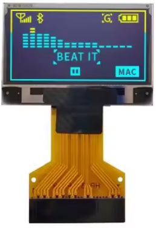

Um painel nu sem PCB de breakout separada - apenas o vidro e a sua fita FPC de 30 pinos, soldada diretamente no footprint `CONN_OLED2` (`FPC30`, WiseChip UG-2864, o nome que este documento usa para o que o esquema chama `LCD1` — ver `BOM/BOM.TXT` e `URTC_NETLIST.TXT`). Dos 30 pinos, apenas um subconjunto está efetivamente ligado — o resto é o bus de interface paralela do painel (`D2`–`D7`, `RW`, `E/!RD`), deixado por ligar uma vez que a placa só comunica com ele por I2C:

| Pino(s) CONN_OLED2 | Net | Função |
|---|---|---|
| 1, 8, 29, 30 | GND / AGND | Terra |
| 9 | VDD | Alimentação lógica (a partir de `+3V3B`, o rail exclusivo do OLED — ver BOM §1) |
| 28 | VCC | Alimentação do painel |
| 2–5 | C2P/C2N/C1P/C1N | Condensadores da bomba de carga — `C26`/`C27` na BOM |
| 26 | IREF | Resistência de definição da corrente de referência |
| 27 | VCOMH | Desacoplamento da tensão comum interna |
| 10, 12 | BS0, BS2 | Ligados a GND |
| 11 | BS1 | Ligado a `+3V3B` |
| 18 | D0/SCK | I2C2 SCL — PA9 |
| 19 | D1/DIN/SDA | I2C2 SDA — PA10 |

`BS0`/`BS1`/`BS2` são o strap de seleção de interface do próprio painel (GND/VCC/GND aqui), fixo em hardware em vez de exposto ao MCU — é isto que coloca o controlador em modo I2C em primeiro lugar, em vez do modo paralelo 8080/6800 a que pertencem os outros 22 pinos FPC.

#### Opção B — módulo breakout (`CONN_OLED`, alternativa externa)


O mesmo painel pré-montado numa pequena placa portadora com um header de 4 pinos - útil se preferires ligar um módulo comercial em vez de arranjar o painel FPC nu. Ligado diretamente ao `CONN_OLED` sem necessidade de cruzar nada — a própria ordem de pinos do módulo (`GND · VDD · SCK · SDA`) coincide exatamente com o pinout do `CONN_OLED`, pino a pino:

| Pino do módulo OLED | Pino CONN_OLED | Sinal |
|---|---|---|
| GND | 1 | Terra |
| VDD | 2 | +3.3V (alimentação lógica do ecrã) |
| SCK | 3 | SCL — PA9, I2C2 por hardware |
| SDA | 4 | SDA — PA10, I2C2 por hardware |

### Splash de arranque

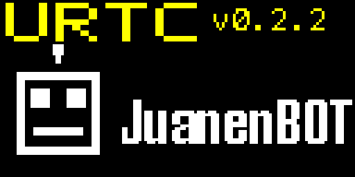


### Ícones de ferramenta (um por perfil, animação de 4 fotogramas)

<table>
<tr>
<td align="center"><br>Ferro de Soldar T12</td>
<td align="center"><br>Doseador de Pasta</td>
<td align="center">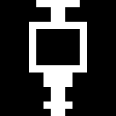<br>Doseador de Líquido</td>
<td align="center"><br>Aparafusadora</td>
</tr>
<tr>
<td align="center"><br>Garra de Vácuo</td>
<td align="center"><br>Berbequim (BL4260)</td>
<td align="center"><br>Garra Gimbal</td>
<td align="center"><br>Garra NEMA</td>
</tr>
<tr>
<td align="center">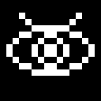<br>Inspeção AOI</td>
<td align="center">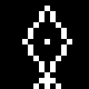<br>Gravador Laser</td>
<td align="center">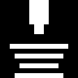<br>Hotend de Impressora 3D</td>
<td align="center"><br>Sonda de Scanner 3D</td>
</tr>
<tr>
<td align="center"><br>Pick & Place SMT</td>
<td align="center"><br>Eletroíman</td>
<td align="center">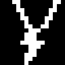<br>Soldadura por Pontos</td>
<td align="center"><br>Revestimento Conformal</td>
</tr>
<tr>
<td align="center">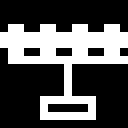<br>Garra de Vácuo (LG)</td>
<td align="center">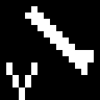<br>Sonda Voadora</td>
<td align="center"><br>Cura UV</td>
<td align="center"><br>Retrabalho de Ar Quente</td>
</tr>
<tr>
<td align="center">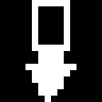<br>Inseridor Press-Fit</td>
<td align="center"><br>Atuador de Crimpagem</td>
<td align="center"><br>Inspeção Térmica</td>
<td align="center">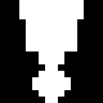<br>Jetting de Pasta</td>
</tr>
<tr>
<td align="center"><br>Soldador Ultrassónico</td>
</tr>
</table>


### Aviso de ID de ferramenta inválido

Se os jumpers de ID não corresponderem a nenhum dos 25 perfis atribuídos, a placa bloqueia todos os atuadores e faz piscar isto em vez disso:


Todos os GIFs de origem das animações encontram-se em [`/ani`](ani/).

## 🔴🟢🔵 LED de Estado Digital

Separado do OLED e do anel de iluminação de 8 píxeis, o `CONN_LED1` transporta um único LED RGB endereçável (família WS2812B, controlado por SPI/DMA) dedicado ao estado num relance.

**Automático por predefinição, anulável pelo host a pedido.** O firmware colore este LED por si próprio, com prioridade em 3 níveis:

* 🔴 **Vermelho** — há uma falha de hardware ativa (`system_error_flag`). Ganha sempre, independentemente do que mais esteja a acontecer.
* 🔵 **Azul** — a placa está ativamente em funcionamento: chegou uma trama CAN (qualquer ID) no último 1.5 segundos.
* 🟢 **Verde** — inativa, à espera de comandos: sem tráfego CAN há mais de 1.5 segundos.

O mestre pode ainda anular isto em qualquer altura enviando o ID CAN `0x100` (DLC 8) com a intensidade de vermelho, verde e azul como os primeiros 3 bytes (0-255 cada um — cor completa de 24 bits, não apenas as 3 automáticas). Uma cor enviada pelo host mantém-se durante 10 segundos antes de voltar ao esquema automático — o suficiente para realmente ser vista, curto o bastante para que a placa não fique presa a mostrar uma cor personalizada desatualizada se o host deixar de a atualizar. Enviar `0x100` novamente (quer a mesma cor, quer uma nova) renova essa janela de 10 segundos, pelo que um host que queira manter o controlo personalizado só precisa de continuar a enviá-lo periodicamente. Uma falha de hardware interrompe sempre uma anulação ativa — o vermelho tem prioridade sobre qualquer cor que o host tenha definido.

Ver `docs/CANBUS.TXT` (ID `0x100`) para o layout exato de bytes, que também partilha esta mesma mensagem com o controlo do anel de LEDs e do modo noturno do OLED.

## 📸 Fotografias

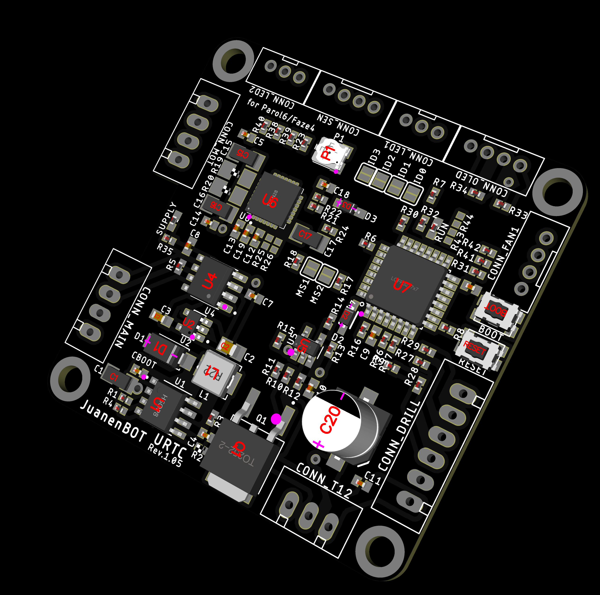

*(Trabalho em curso — mais ângulos e uma placa montada em breve.)*

## 🔧 Compilação e Gravação

A flash do URTC está dividida em 2 peças independentes, para que a placa possa ser regravada pelo mesmo cordão umbilical CAN que já utiliza para tudo o resto — sem nunca mais precisar de acesso físico ao header JTAG/SWD depois da configuração inicial.

### Layout da memória flash (256K no total, modelo de imagem dourada / atualização A-B)

```
0x08000000 ┌─────────────────────────────────┐
           │  Bootloader (30K)                 │  Executa-se sempre primeiro em cada
           │                                   │  arranque. Escuta brevemente por
           │                                   │  CAN e depois ou salta para a app ou
           │                                   │  espera por uma atualização. Controla
           │                                   │  o OLED diretamente durante uma
           │                                   │  atualização (ver abaixo).
0x08007800 ├─────────────────────────────────┤
           │  Página de metadados (2K)         │  Descreve o que quer que esteja no
           │                                   │  slot principal neste momento:
           │                                   │  HardwareID, versão, tamanho, CRC32
           │                                   │  e uma assinatura HMAC-SHA256. O
           │                                   │  bootloader verifica tudo isto antes
           │                                   │  de saltar para a app.
0x08008000 ├─────────────────────────────────┤
           │  Slot principal (112K)            │  Este é o firmware de aplicação /
           │                                   │  URTC_MAIN_FIRMWARE_v<version>.* — o firmware
           │                                   │  real que corre no dia a dia,
           │                                   │  descrito em todo o resto deste
           │                                   │  README. Nunca é tocado por uma
           │                                   │  atualização até que uma imagem
           │                                   │  verificada e sabidamente boa esteja
           │                                   │  pronta para o substituir.
0x08024000 ├─────────────────────────────────┤
           │  Slot de cópia de segurança /     │  Apenas armazenamento em bruto,
           │  staging (112K)                   │  nunca executado diretamente. Cada
           │                                   │  atualização CAN escreve aqui
           │                                   │  primeiro.
0x08040000 └─────────────────────────────────┘
```

**Porquê um slot de cópia de segurança.** Uma atualização CAN nunca é escrita no slot que está atualmente em execução. Vai primeiro para a cópia de segurança, é totalmente verificada aí — tamanho, CRC32 e uma verificação HMAC-SHA256 com uma chave simétrica partilhada, que mostra que foi produzida por quem possui essa chave (as imagens publicadas usam a chave pública de desenvolvimento), e não apenas que chegou intacta — e só então é copiada para o slot principal. Uma perda de energia em qualquer ponto antes de essa cópia começar deixa o firmware atualmente em execução completamente intacto, pelo que não existe nenhuma janela em que uma transferência interrompida possa inutilizar a placa. Se a perda de energia ocorrer *durante* a própria cópia, o bootloader apercebe-se no arranque seguinte (a cópia de segurança, nunca tocada durante a cópia, continua totalmente intacta) e simplesmente retoma a cópia a partir dela até ter sucesso.

### 0. Compilar a partir do código-fonte (opcional — os binários pré-compilados são assets de cada release do GitHub, não ficheiros do repositório)

Duas formas de ir do código-fonte deste repositório até aos 4 binários acima:

- **Automatizada:** `build_firmware.sh` (Linux) ou `build_firmware.bat` (Windows), na raiz do repositório. Qualquer um dos dois instala a toolchain ARM GNU se esta faltar, obtém o commit fixado do ST HAL/CMSIS, e compila, liga e aplica `objcopy` aos 4 binários (app + bootloader da placa principal, app + bootloader do escravo de expansão) diretamente em `firmware/`, e depois regenera `firmware/firmware_manifest.json`. Executa-o sem argumentos para uma build completa, `--clean` para esvaziar primeiro a cache local `build/`, ou `master`/`slave` para compilar apenas o par próprio de um chip. O `build_firmware.sh` corre de ponta a ponta contra a árvore de código-fonte real deste projeto; o `build_firmware.bat` espelha essa mesma lógica para Windows — se alguma vez divergirem, confia na lógica do script `.sh` como referência.
- **Manual:** cada comando que qualquer um dos 2 scripts executa, mais o raciocínio por trás de cada escolha de toolchain/HAL, está detalhado passo a passo em `docs/COMPILE_STM32F303.TXT` — útil num sistema operativo diferente, com uma fonte HAL/CMSIS diferente, ou simplesmente para ver exatamente o que os scripts automatizam.
- **Assets da release:** as imagens de firmware (`.bin`, `.hex`, `.elf` e os respetivos ficheiros de soma de verificação e manifesto) não são versionadas no git. `build_firmware.sh`/`.bat` escrevem-nas em `firmware/` (ignorada pelo git; `build/firmware` em modo CI, `URTC_CI=1`), e `python tools/publish_release_assets.py` verifica o conjunto e imprime o comando `gh release create` exato com os ficheiros a anexar. São publicadas apenas como assets da release do GitHub de cada versão. Quem lê o quê: [`docs/FIRMWARE_DISTRIBUTION.md`](docs/FIRMWARE_DISTRIBUTION.md).

Depois de qualquer alteração ao código-fonte do firmware (ou antes de confiar num incremento de versão), executa **`check_version_consistency.sh`** a partir da raiz do repositório: lê as constantes de versão das Pistas A/E (firmware da placa principal, aplicação do escravo de expansão) como fonte de verdade e verifica cada localização que o `VERSION_CHECKLIST.txt` documenta para essa etiqueta de versão, reportando qualquer discrepância — apenas reporta, não corrige nada por si próprio. O `VERSION_CHECKLIST.txt` é a referência completa das 5 pistas de versão independentes que este projeto tem (firmware principal, hardware/PCB, bootloader principal, aplicação do escravo de expansão, bootloader do escravo de expansão) e de exatamente o que é preciso alterar ao incrementar qualquer uma delas.

### 1. Configuração inicial — requer JTAG/SWD (uma vez)

O bootloader só consegue chegar ao chip por programação física — não há forma de gravar por CAN uma placa que ainda não tem um bootloader instalado. Este é um passo único:

1. Abre o projeto no **STM32CubeIDE** (construído e testado para o alvo STM32F303CC), ou usa diretamente o **STM32CubeProgrammer** com as saídas compiladas abaixo.
2. Grava **ambas** as imagens por SWD (ST-Link) através do header `STM_JTAG` integrado — cada ficheiro `.hex` tem o seu endereço de destino incorporado, pelo que a maioria das ferramentas (incluindo o STM32CubeProgrammer) consegue carregar ambas na mesma sessão:
   * `URTC_MAIN_BOOTLOADER_v<version>.hex` → `0x08000000`
   * `URTC_MAIN_FIRMWARE_v<version>.hex` → `0x08008000`
3. Define a identidade da ferramenta através dos jumpers de soldadura de ID antes de ligar - a placa lê-os uma vez no arranque, como sempre. Cinco jumpers (ID0-ID4), cobrindo o espaço completo de 32 endereços (31 endereços de ferramenta diretos, mais o endereço reservado `11111` de configuração livre - ver a secção da Matriz de Ferramentas acima).
4. Liga. O bootloader escuta durante ~600ms, não vê nada e salta diretamente para a aplicação — a partir daqui, tudo se comporta exatamente como descrito no resto deste README. A janela começa depois de o bootloader ter verificado a aplicação guardada, e uma ferramenta que queira atualizar tem de enviar dentro dela a trama de início de atualização (0x7F1); o estado de escuta (0x7F5 = 0x01) é enviado quando a janela termina sem salto, e não no seu início.

**O header JTAG nunca é removido nem desativado.** Está sempre lá como alternativa — se uma atualização CAN alguma vez correr mal, ou se simplesmente preferires, podes regravar qualquer uma das 2 imagens por SWD a qualquer momento.

**Dois botões integrados, BOOT e RESET**, também estão lá para recuperação — o RESET é um reset de hardware normal (`NRST`), e o BOOT coloca `BOOT0` em alto, o que é uma decisão ao nível do chip tomada *antes* de qualquer coisa deste repositório correr: normalmente (sem premir) o chip arranca da flash para o bootloader próprio deste projeto, como descrito acima; premido durante o reset, arranca em vez disso para o bootloader de System Memory de fábrica da ST (recuperação por USB DFU/UART, completamente separada de tudo o que está aqui). Ver `src/F303-master/README.md` secção 4a para o detalhe técnico completo.

### 2. Atualizações seguintes — por bus CAN

Assim que o bootloader está instalado, atualizar a aplicação deixa de precisar de acesso físico à placa — basta enviar a nova build de firmware pela mesma linha CAN umbilical que já transporta comandos para a cabeça da ferramenta.

**A sequência de atualização:**

1. **Disparo.** O mestre envia `0x7F0` (DLC 4, payload `B0 07 1D 5A`) para a *aplicação em execução*. Esta corta com segurança a energia de cada atuador em linha — motores, aquecedores, laser — e faz reset ao chip. Este requisito de payload mágico significa que uma trama corrompida ou malformada não pode disparar acidentalmente um reset para o modo de atualização.
2. **Início.** Após o reset, o bootloader está à escuta. O mestre envia `0x7F1` (DLC 8, tamanho total do firmware big-endian + HardwareID big-endian). Uma imagem construída para hardware diferente é rejeitada logo aqui, antes de um único byte de flash ser tocado. O bootloader apaga exatamente tantas páginas do slot de cópia de segurança quantas a nova imagem precisar e responde com uma trama de estado (`0x7F5`).
3. **Assinatura.** O mestre envia a assinatura HMAC-SHA256 esperada como 4 tramas `0x7F7` (8 bytes cada uma, por ordem) — calculada sobre a imagem de firmware com uma chave partilhada entre o bootloader e a ferramenta que assina a build. É uma chave simétrica partilhada, pelo que a verificação só prova que a imagem veio de quem possui essa chave, não de quem se trata; as imagens publicadas usam a chave pública de desenvolvimento (ver `docs/FIRMWARE_SIGNING.TXT`).
4. **Dados.** O mestre transmite o ficheiro `.bin` como uma sequência de tramas `0x7F2` (até 8 bytes de dados de firmware em bruto cada uma), enviadas uma a seguir à outra — o CAN garante que as tramas chegam pela ordem em que foram enviadas num único bus, pelo que não é necessário um número de sequência por trama. O bootloader acumula os bytes recebidos numa página de 2KB em RAM e escreve-a no slot de *cópia de segurança* quando está cheia, relendo cada meia palavra e comparando-a com o que devia ter sido escrito antes de dar a página por concluída, e enviando um reconhecimento `0x7F3` (com o índice da página) após cada escrita verificada. Uma implementação razoável do mestre espera pelo ACK de cada página antes de enviar os dados da seguinte, para evitar sobrecarregar o buffer de receção do bootloader.
5. **Fim e verificação.** Depois de cada byte ter sido enviado, o mestre envia `0x7F4` (DLC 8, CRC32 big-endian + versão maior/menor). O bootloader verifica o tamanho do slot de cópia de segurança, calcula o seu CRC32 e HMAC-SHA256 e compara ambos com o que o mestre declarou. Só se tudo coincidir é que prossegue para copiar a cópia de segurança para o slot principal, página a página, com a mesma verificação por releitura acima. Quando essa cópia está completa e confirmada, guarda os novos metadados e faz reset para a aplicação atualizada. Perante qualquer discrepância — tamanho, CRC32, HMAC ou HardwareID — o slot principal nunca é tocado, e o bootloader simplesmente volta a escutar por uma nova tentativa.

**Tramas de estado (`0x7F5`, DLC 1):** `0x01` à escuta, `0x02` a apagar, `0x03` a receber, `0x06` a verificar, `0x07` a copiar a cópia de segurança para o principal, `0x04` verificado OK (prestes a saltar), `0x05` verificação falhada, `0xFF` erro.

**Heartbeat (`0x7F6`, DLC 2, a cada ~1s enquanto escuta ou atualiza):** byte de estado + percentagem de progresso (0-100, ou `0xFF` quando uma percentagem não se aplica). Permite ao mestre distinguir "o nó está vivo mas ainda não começou a escutar" de "o nó está completamente sem resposta" - útil para o arranque automatizado e para detetar um bootloader bloqueado sem esperar por um timeout.

**Progresso no ecrã.** O bootloader controla o OLED diretamente durante uma atualização — ninguém tem de adivinhar se alguma coisa está a acontecer. Mostra "UPDATING" mais uma barra de progresso em direto e uma percentagem enquanto as páginas são escritas ou copiadas, "FLASH OK" por um instante antes de fazer reset para o novo firmware, e "ERROR" se a escrita de uma página falhar, a transferência ficar parada durante mais de 10 segundos, ou a verificação resultar numa discrepância.

**⚠️ Testa isto em bancada antes de confiares nisto no terreno.** O protocolo acima compila e liga sem problemas e a lógica foi cuidadosamente ponderada, mas um bootloader é exatamente o tipo de firmware em que "compila corretamente" está muito longe de "fiável em hardware" — o timing real de programação da flash, o comportamento do CAN numa transferência de vários milhares de tramas e a passagem de testemunho bootloader-para-aplicação precisam todos de ser verificados numa placa real (idealmente com JTAG à mão como alternativa) antes de confiar nisto para uma atualização sem supervisão com atuadores reais ligados.

### Ferramentas de PC

Duas ferramentas GUI independentes e multiplataforma (Windows/Linux)
dão suporte a esta placa - o **URTC Flasher** (atualizações CAN-OTA e
de chip completo por SWD/JTAG, tanto para esta placa como, numa
variante de expansão Avançada, para o seu próprio chip escravo de
expansão) e o **URTC Tester** (um exercitador em direto do bus CAN que
mostra o perfil de ferramenta que estiver com jumpers em cada momento).
Ambas costumavam viver dentro deste repositório em `tools/`; cada uma é
agora o seu próprio projeto independente, com o seu próprio README,
licença e traduções:

- [URTC Flasher](https://github.com/JuanenRac/URTC-FLASHER)
- [URTC Tester](https://github.com/JuanenRac/URTC-TESTER)

Existe também uma alternativa baseada na web que cobre terreno
semelhante (monitorização em direto, análise CAN, gravação OTA,
inspeção térmica) sem instalar nada localmente:
[URTC Web Studio](https://github.com/JuanenRac/URTC-WEB-STUDIO).

## 🛡️ Proteção térmica (testada apenas no anfitrião), assinatura de firmware (chave de desenvolvimento) e CAN (sem autenticação)

- **Proteção contra descontrolo térmico** (`thermal_guard.c`, desde a aplicação 0.3.2) no ferro de soldar / ar quente e no hotend 3D: um MAXTEMP sobre a temperatura *medida* (449 °C T12, 310 °C hotend), uma vigilância de aquecimento (a temperatura tem mesmo de subir com o aquecedor ligado - deteta um termístor ou uma ponta solta) e uma verificação de manutenção (uma vez atingido o alvo, sem quedas prolongadas com o aquecedor ligado). Uma falha corta o aquecedor, trava o erro da placa e indica a causa no byte 4 de `0x111`. Testado no host com um aquecedor simulado (`tests/test_thermal_guard.c`). Os seus limites nunca foram medidos num aquecedor real e nada disto foi alguma vez executado numa placa.
- **Testes de anfitrião da lógica do firmware à volta do hardware** (`tools/run_host_tests.py`, 38 suites): além do bootloader, da guarda térmica e do despachante, os verdadeiros tratadores CAN das 13 ferramentas (`firmware_can_*.c`), os ciclos de controlo do aquecedor (`firmware_control_thermal.c`: conversão do ADC, leituras impossíveis, limites do valor pretendido, histerese, aquecedor preso, as avarias da guarda), o gravador de avarias (`firmware_blackbox.c`, comparado byte a byte com os cenários que o URTC-COMMON escreve a partir do seu próprio modelo, e a sua leitura CAN), a identificação da ferramenta pelos jumpers, os comandos depois da porta de erro e os comandos da câmara térmica são compilados contra uma HAL falsa (`tests/host_hal/`) e executados com os sanitizers de endereços e de comportamento indefinido e `gcc -fanalyzer`; `--coverage-floor` (`URTC_COVERAGE_FLOOR` no CI) obriga-os a uma parte de linhas executadas (95 por cento das linhas das 78 fontes do firmware, que agora incluem o arranque e o ciclo principal da aplicação, o controlador do OLED e os seus ecrãs, o LED de estado, os tratadores de interrupção, os barramentos do conector de expansão, as três câmaras térmicas, o escravo de expansão e os programas principais dos dois bootloaders; o piso do CI é 90). Nada disto correu numa placa.
- **Diagnóstico:** o byte 5 de `0x111` indica a causa do último reinício (bit0 = disparou o watchdog de hardware); `0x1AA`/`0x1AB` devolvem contadores de vida guardados na F-RAM - falhas térmicas, código da última falha e tempo total com o aquecedor ligado (desde 0.3.3); as amostras da caixa negra registam o código de falha térmica.
- **Assinatura do firmware:** a chave HMAC dos bootloaders é injetada na compilação a partir de um ficheiro privado (`URTC_SIGNING_KEY_FILE`); sem ele, o build usa a *chave pública de desenvolvimento* e avisa disso, e `URTC_RELEASE=1` rejeita-a. Cada imagem em `firmware/` vem acompanhada de `<bin>.sha256` e `<bin>.manifest.json` (com a assinatura já calculada), pelo que o URTC Flasher e o URTC Web Studio não transportam qualquer chave. Ver [`docs/FIRMWARE_SIGNING.TXT`](docs/FIRMWARE_SIGNING.TXT). HMAC é uma chave simétrica partilhada: as imagens de aplicação publicadas são assinadas com a chave pública de desenvolvimento, pelo que qualquer pessoa pode assinar uma imagem que uma placa compilada com essa chave aceita; uma assinatura assimétrica (Ed25519) está prevista. Cada ficheiro de uma release oficial leva também uma assinatura de release Ed25519 separada (`<ficheiro>.sig`, chave pública em [`docs/RELEASE_SIGNING.md`](docs/RELEASE_SIGNING.md)); o flasher e o web studio verificam-na quando existe.
- **Bus CAN:** não autentica o emissor - qualquer nó pode dar ordens às ferramentas. As instalações com laser, aquecedores ou soldadura **têm de** ter um interlock de hardware independente do MCU e um bus fechado: [`docs/CAN_THREAT_MODEL.TXT`](docs/CAN_THREAT_MODEL.TXT).
- **Várias cabeças de ferramenta no mesmo barramento CAN (desligado por predefinição):** um interruptor persistente (CAN `0x1AC` altera-o, `0x1AD` lê-o, o registo na F-RAM está descrito em [`docs/EEPROM.TXT`](docs/EEPROM.TXT)) ativa os endereços de nó tirados dos cinco jumpers de ID, a descoberta e uma regra de seleção: só a cabeça selecionada obedece a comandos e uma cabeça não selecionada nunca aciona nada. Com o interruptor desligado, que é a predefinição e também o que lê uma F-RAM em branco, a placa comporta-se exatamente como uma única cabeça e as tramas e os identificadores não mudam. Implementado no firmware e testado apenas no computador; não foi experimentado em placas. O desenho e as tramas estão em URTC-COMMON (`docs/MULTINODE.md`) e no apêndice de [`docs/CANBUS.TXT`](docs/CANBUS.TXT).
- **O que o bootloader responde e o número de patch do escravo:** a leitura de volta (`0x7FE`) e a autorização de regressão de versão (`0x7FD`) só são respondidas numa sessão do bootloader que a aplicação iniciou ao aceitar `0x7F0` (ou numa placa sem aplicação válida); depois de uma ligação normal são ignoradas, e uma opção de compilação desliga isto. O escravo de expansão envia o seu número de patch no décimo byte do registo de versão e o mestre reencaminha-o em `0x222` (um byte 0 significa não enviado, como num escravo mais antigo), seguido do byte baixo do seu número menor num terceiro byte, para que um programa possa mostrar a versão completa. Está no código-fonte e testado no anfitrião; nenhuma imagem de firmware o inclui ainda.

## 📋 Registo de Alterações

O firmware e o bootloader são versionados e publicados de forma
independente - gravar um novo bootloader não implica uma nova versão da
aplicação e vice-versa, pelo que cada um tem o seu próprio histórico
no seu próprio ficheiro, em vez de um número de versão combinado que
implicaria que avançam sempre juntos:

- Firmware (`src/F303-master/`): [`src/F303-master/CHANGELOG.md`](src/F303-master/CHANGELOG.md)
- Bootloader (`src/F303-master/boot/`): [`src/F303-master/boot/CHANGELOG.md`](src/F303-master/boot/CHANGELOG.md)
- Aplicação do escravo de expansão (`src/F303-slave/`, STM32F303CBT6): [`src/F303-slave/CHANGELOG.md`](src/F303-slave/CHANGELOG.md)
- Bootloader do escravo de expansão (`src/F303-slave/boot/`): [`src/F303-slave/boot/CHANGELOG.md`](src/F303-slave/boot/CHANGELOG.md)

**Política de versionamento:** os 4 componentes (2 firmwares de aplicação, 2 bootloaders - `FIRMWARE_VERSION_MAJOR`/`MINOR`/`PATCH` e `BOOTLOADER_VERSION_MAJOR`/`MINOR`/`PATCH`) são **incrementais** - o `PATCH` próprio de cada componente sobe em 1 apenas com o passo explícito `python bump.py` (que usa o `bump_version.py` na raiz do repositório); compilar nunca altera uma versão, com transporte para `MINOR` (e depois `MAJOR`) quando o `PATCH` passaria de 9, a mesma regra de "conta-quilómetros" em base 10 que usa um conta-quilómetros real - p. ex. `0.1.7` → `0.1.8` → `0.1.9` → `0.2.0`, nunca `0.1.10`. Cada bootloader mantém ainda a sua própria cópia do `FIRMWARE_VERSION_*` da aplicação correspondente, sincronizada automaticamente pelo mesmo bump. Ver [`CHANGELOG.md`](CHANGELOG.md) na raiz do repositório para o estado atual dos 4 componentes num relance, e [`VERSION_CHECKLIST.txt`](VERSION_CHECKLIST.txt) para a mecânica completa por pista.

## 🔍 Estado Atual

**Firmware (`src/F303-master/`):** completo em funcionalidade para os 25 perfis de ferramenta — controlo térmico ligar/desligar com histerese, telemetria por ferramenta, watchdogs de comunicação, deteção de stall/falha e o próprio diagnóstico em direto do OLED, a par de um par de consulta de ferramenta ativa (`0x110`/`0x111`), uma passagem SPI genérica (`0x180`/`0x181`) para o conector de expansão, uma F-RAM integrada que guarda os setpoints através de uma falha de energia (`0x190`/`0x191`), o mecanismo de configuração livre de ferramenta com o jumper `11111` (`0x1A2`/`0x1A3`), reporte de tipo de periférico + número de série do dispositivo (`0x1A4`/`0x1A5`) para distinguir várias placas por outro lado idênticas num bus partilhado, e uma ponte CAN-para-I2C (`0x210`-`0x221`) que alcança o chip escravo de expansão em placas de expansão avançadas. Versionado independentemente do bootloader (ver o Registo de Alterações abaixo). Nada disto foi alguma vez executado numa placa real e a proteção térmica só foi testada no anfitrião com um aquecedor simulado.

**Bootloader (`src/F303-master/boot/`):** sistema de atualização A/B de imagem dourada completo em funcionalidade — atualizações OTA por CAN verificadas com CRC32 e um HMAC-SHA256 de chave partilhada (não uma assinatura assimétrica), um slot de cópia de segurança que garante que uma atualização falhada nunca inutiliza a placa, e o seu próprio reporte de versão (`0x7FA`) independente da aplicação. Compila e liga sem problemas; ver o aviso de teste em bancada acima antes de confiar nele sem supervisão com atuadores reais ligados.

**Ferramentas de PC:** tanto o [URTC Flasher](https://github.com/JuanenRac/URTC-FLASHER) (atualizações CAN OTA + programação de chip completo por SWD/JTAG) como o [URTC Tester](https://github.com/JuanenRac/URTC-TESTER) (exercitador em direto de controlo/telemetria por ferramenta) estão completos em funcionalidade para aquilo a que se propuseram, cada um agora o seu próprio projeto independente com o seu próprio README que cobre a configuração e cada controlo em detalhe.

**Hardware:** o esquema e a BOM ainda estão a ser finalizados; ainda não existe nenhuma placa montada para validar nada do que está acima contra silício real. Tudo o que está acima compila, liga e foi cuidadosamente ponderado, mas "compila corretamente" e "verificado em hardware" são 2 afirmações diferentes — ver o aviso de segurança no início deste README, e trata um primeiro arranque com a cautela que qualquer placa nova merece.

Se alguém da comunidade estiver a trabalhar em efetores finais personalizados, trocadores de ferramenta inteligentes ou integração avançada de ferramentas para o PAROL6, o Faze4 ou qualquer outra plataforma de braço robótico, adoraria conversar, trocar ideias ou aprofundar os comandos CAN!

## 📂 Estrutura do Repositório

```
/
├── 3D/
│   ├── RACK/                    Rack de montagem da placa, 2 variantes (x1, x3) - cada uma
│   │                            em .stl/.3mf/.amf/.scad
│   ├── REVOLVER/                Placeholder - vazio, conteúdo ainda não iniciado
│   └── TOOLS/
│       └── PAROL6/              Peças imprimíveis em 3D por ferramenta para o braço robótico
│                                PAROL6 - uma subpasta por ferramenta (0.Universal parts, depois
│                                1-12 segundo a numeração do Catálogo de Ferramentas acima),
│                                cada uma em .stl/.3mf/.amf/.scad onde está preenchida; várias
│                                (4, 6-12) continuam a ser placeholders vazios
├── ani/                          27 GIFs: uma animação de 4 fotogramas por perfil de ferramenta
│                                 (00-24, a coincidir com o ID numérico de cada
│                                 ferramenta), o splash de arranque (splash_boot.gif) e o
│                                 aviso de ID inválido (error_warning.gif) - todos
│                                 descodificados diretamente a partir do código-fonte do
│                                 firmware deste projeto (as próprias tabelas
│                                 ToolIcons[]/SplashFace[]/ErrorText[] de firmware_render.c), não
│                                 desenhados à mão em separado, pelo que coincidem sempre com o
│                                 que o OLED real efetivamente mostra
├── BOM/
│   ├── BOM.TXT                  Lista de materiais completa da placa PCB
│   ├── BOM_EXPANSION_BASIC_TMC2209.TXT     Placa de expansão, básica + TMC2209
│   ├── BOM_EXPANSION_BASIC_TMC5160A.TXT    Placa de expansão, básica + TMC5160A
│   ├── BOM_EXPANSION_ADVANCED_TMC2209.TXT  Placa de expansão, avançada + TMC2209
│   ├── BOM_EXPANSION_ADVANCED_TMC5160A.TXT Placa de expansão, avançada + TMC5160A
│   ├── BOM_EXPANSION_BASIC_ADS1115.TXT     Placa de expansão, básica + ADS1115 (só sensor, sem driver/MCU)
│   └── BOM_EXPANSION_BASIC_MLX9064X.TXT    Placa de expansão, básica + MLX9064x (só sensor, sem driver/MCU)
├── docs/
│   ├── CANBUS.TXT               Referência do protocolo do bus CAN (todos os IDs de comando/telemetria)
│   ├── ECOVIA.TXT               Matriz de identificação de ferramentas e lógica de mutação de pinos
│   ├── TOOLS.TXT                Catálogo de alto nível das 25 ferramentas - o que cada uma faz e
│   │                            que periféricos utiliza, sem detalhe ao nível dos pinos
│   ├── PINOUT.TXT               Pinout completo do MCU, bloco a bloco
│   ├── PINOUT_CONNECTORS.TXT    Pinouts físicos dos conectores (CONN_DRILL, CONN_SEN, etc.)
│   ├── EXPANSION.TXT            Conector CONN_EXPANSION e as variantes de placas adicionais
│   ├── PINOUT_SLAVE.txt         Pinout completo do chip escravo de expansão (apenas variantes avançadas)
│   ├── EEPROM.TXT               Mapa completo de registos da F-RAM (cada definição persistida, offsets de bytes)
│   ├── COMPILE_STM32F303.TXT    Guia de compilação do zero dos 4 binários de firmware -
│   │                            toolchain, configuração do ST HAL/CMSIS, comandos exatos de compilação/ligação;
│   │                            build_firmware.sh/.bat na raiz do repositório automatizam este mesmo
│   │                            processo de ponta a ponta
│   ├── FIRMWARE_DISTRIBUTION.md Onde os ficheiros de firmware são publicados e o que cada consumidor lê
│   ├── FIRMWARE_SIGNING.TXT     Como as imagens de firmware são assinadas: HMAC hoje, Ed25519 previsto
│   ├── RELEASE_SIGNING.md       Como uma versão publicada é assinada (assinatura Ed25519 separada de cada ficheiro) e a chave pública
│   ├── KEYS.md                  Cada chave de que a família depende: finalidade, valor público, onde está incorporada e onde vive a metade privada
│   ├── CAN_THREAT_MODEL.TXT     No que o barramento CAN confia e os requisitos de instalação que daí resultam
│   ├── COMPATIBILITY.md         Que versões dos programas funcionam em conjunto (gerado por URTC-COMMON)
│   ├── datasheet/               2 datasheets de componentes ainda não cobertos em
│   │                            PCB/datasheet/ (CFM_40.pdf, EFB0424VHD-CP0.pdf)
│   └── tool_image_generator/    Kit de ferramentas que gera images/TOOL_*.png (ver abaixo) -
│                                render_engine.py + tool_data.py + generate_all.py, e
│                                PROCEDURE.TXT a explicar como adicionar a imagem de uma nova
│                                ferramenta ou regenerar uma existente
├── src/
│   ├── F303-master/
│   │   ├── STM32F303CC_main.c    Ponto de entrada - definições globais e main()
│   │   ├── firmware_*.c/.h       ~100 ficheiros adicionais, um por subsistema (OLED, LEDs, handlers
│   │   │                         CAN por ferramenta, init, persistência, etc.), incluindo
│   │   │                         firmware_ads1115.c (driver ADS1115 direto, placa
│   │   │                         Basic+ADS1115) - ver o README.md desta pasta para a
│   │   │                         tabela completa ficheiro a ficheiro
│   │   ├── melexis_mlx90640/     A biblioteca oficial MLX90640 da própria Melexis (Apache-2.0,
│   │   │                         C puro) mais o driver de ligação direta desta placa
│   │   │                         por cima dela, para a placa de expansão Basic+MLX9064x
│   │   ├── melexis_mlx90641/     A mesma ideia, biblioteca MLX90641 (Apache-2.0, C++ - ver a
│   │   │                         secção 8a do README.md desta pasta para saber porque é que esta
│   │   │                         biblioteca é C++ num projeto de resto todo em C)
│   │   ├── melexis_mlx90642/     A mesma ideia, biblioteca MLX90642 (Apache-2.0, C puro) - ver
│   │   │                         a secção 8a para saber porque é que o driver deste sensor é genuinamente
│   │   │                         mais simples do que o dos outros 2
│   │   ├── STM32F303CCTx_APP.ld  Linker script da aplicação (slot principal de 112K em 0x08008000)
│   │   ├── README.md             Referência técnica: plataforma de hardware, o sistema de
│   │   │                         seleção de ferramenta por jumpers de ID, cablagem de periféricos por
│   │   │                         ferramenta - ver CANBUS.TXT para o protocolo ao nível do fio de que isto explica o porquê
│   │   └── boot/
│   │       ├── bootloader_main.c  Ponto de entrada do bootloader
│   │       ├── bootloader_*.c/.h  9 ficheiros adicionais (tipos/constantes partilhados, cripto,
│   │       │                      flash/metadados, OLED, protocolo CAN)
│   │       ├── STM32F303CCTx_BOOTLOADER.ld  Linker script do bootloader (região de 30K em 0x08000000)
│   │       └── README.md          O mesmo papel de referência técnica que o da aplicação, para o bootloader
│   ├── common/                   Cabeçalhos partilhados pela aplicação, pelo bootloader e pelo escravo: a marca da sessão de arranque, os registos do escravo e o formato da versão no barramento
│   └── F303-slave/               Chip companheiro (STM32F303CBT6) apenas nas 2 variantes de placa de
│       │                         expansão AVANÇADAS - ver a secção Conector de Expansão
│       │                         acima. Par bootloader/aplicação próprio, protocolo de atualização
│       │                         próprio baseado em I2C (não CAN), versionamento independente próprio.
│       ├── slave_main.c          Ponto de entrada
│       ├── slave_*.c/.h          7 ficheiros adicionais (tipos/constantes partilhados, protocolo de
│       │                         ligação I2C, bus de sensores local, PWM local)
│       ├── STM32F303CBTx_SLAVEAPP.ld  Linker script (slot principal de 54K em 0x08005000)
│       ├── README.md             Referência técnica: porque é que este chip existe, o bus de sensores
│       │                         local ADS1115/MLX9064x, PWM local, o protocolo de ligação
│       │                         I2C com a placa principal
│       ├── melexis_mlx90640/     A biblioteca oficial MLX90640 da própria Melexis (Apache-2.0,
│       │                         C puro, não modificada, ficheiro de licença próprio) - mantida como unidade
│       │                         de compilação separada, deliberadamente nunca integrada no
│       │                         código-fonte deste projeto, uma vez que a Apache-2.0 exige que o
│       │                         aviso de copyright desse código se mantenha intacto
│       ├── melexis_mlx90641/     A biblioteca oficial MLX90641 da própria Melexis (Apache-2.0, C++ -
│       │                         uma biblioteca genuinamente separada da MLX90640, não uma
│       │                         variante dela - ver a secção 3 do README.md desta pasta
│       │                         para saber porque é C++ e como a build lida com isso)
│       ├── melexis_mlx90642/     A biblioteca oficial MLX90642 da própria Melexis (Apache-2.0, C
│       │                         puro) - interface de transporte genuinamente mais simples do que a dos outros
│       │                         2 sensores, ver README.md secção 3 para saber porquê
│       └── boot/
│           ├── slaveboot_main.c   Ponto de entrada do bootloader
│           ├── slaveboot_*.c/.h   7 ficheiros adicionais (cripto, flash/metadados, protocolo)
│           ├── STM32F303CBTx_SLAVEBOOT.ld  Linker script (região de 18K em 0x08000000)
│           └── README.md          O mesmo papel de referência técnica que o da aplicação
├── firmware/  (saída de compilação ignorada pelo git - publicada apenas como assets da release)
│   ├── URTC_MAIN_BOOTLOADER_v<version>.bin  Bootloader compilado, gravar em 0x08000000
│   ├── URTC_MAIN_BOOTLOADER_v<version>.elf  Bootloader compilado, gravar em 0x08000000
│   ├── URTC_MAIN_BOOTLOADER_v<version>.hex  Bootloader compilado, gravar em 0x08000000 (endereço incorporado)
│   ├── URTC_MAIN_FIRMWARE_v<version>.bin    Bin da aplicação compilado, gravar em 0x08008000
│   ├── URTC_MAIN_FIRMWARE_v<version>.elf    Elf da aplicação compilado, gravar em 0x08008000
│   ├── URTC_MAIN_FIRMWARE_v<version>.hex    HEX da aplicação compilado, gravar em 0x08008000 (endereço incorporado)
│   ├── URTC_SLAVE_BOOTLOADER_v<version>.{bin,elf,hex}  Bootloader próprio do escravo de expansão, gravar em 0x08000000
│   │                             no STM32F303CBT6 (apenas placas de expansão avançadas)
│   ├── URTC_SLAVE_FIRMWARE_v<version>.{bin,elf,hex}  Aplicação própria do escravo de expansão, gravar em 0x08005000
│   └── firmware_manifest.json    Índice legível por máquina dos 4 componentes acima - versão,
│                                 endereço de flash e tamanho/CRC32 de cada ficheiro, para uma
│                                 ferramenta externa verificar o que aqui está e o que é mais recente do que
│                                 aquilo que já possui. Regenerado automaticamente por
│                                 generate_manifest.py (chamado pelo último passo do
│                                 build_firmware.sh/.bat) - nunca editado à mão.
├── images/
│   ├── OLED_DIRECT_MOUNT.jpg     LCD1/CONN_OLED2 - painel FPC nu de 30 pinos, opção de montagem direta
│   ├── OLED_BREAKOUT_MODULE.jpg  CONN_OLED - módulo breakout I2C externo, opção alternativa
│   ├── URTC_BANNER.svg             Logótipo geral do projeto, incorporado no topo deste README
│   ├── URTC_BOARD.png           Fotografia da placa
│   ├── URTC_SCHEMATIC.png       Esquema da placa
│   ├── URTC_PCB_TOP.png         Camada TOP da placa (quando adicionada)
│   ├── URTC_PCB_BOTTOM.png      Camada BOTTOM da placa (quando adicionada)
│   └── TOOL_*.png               Diagrama de referência de jumpers/cablagem por ferramenta, um por perfil
│                                (todos os 25 presentes - ver a ligação de cada ferramenta no Catálogo de Ferramentas acima)
├── PCB/
│   ├── URTC_V1.0.sch            Esquema Eagle (quando adicionado)
│   ├── URTC_V1.0.brd            Layout da placa Eagle (quando adicionado)
│   ├── URTC_V1.0_JLCPCB.ZIP     Ficheiros Gerber, bom e cpl (quando adicionados)
│   ├── URTC_BOM.TXT             BOM em bruto exportada do Eagle (exportação de referência - ver
│   │                            BOM/BOM.TXT para a versão organizada e curada deste projeto)
│   ├── datasheet/               Datasheets de todas as peças usadas na placa
│   └── *_PARLIST/PINLIST/NETLIST.TXT   Netlists exportadas do Eagle (referência para o mapeamento de pinos)
├── keys/ registry.json: as chaves públicas da família e onde cada uma está incorporada (verificado por tools/keys.py)
├── tests/ Testes do firmware no anfitrião, compilados contra um HAL simulado (tests/host_hal/) e os vetores partilhados, mais os testes das ferramentas Python
├── tools/
│   ├── build_test.py            Verificação de build/compilação sem alteração de versão
│   ├── publish_release_assets.py  Lista os assets da release e imprime o comando gh
│   ├── ci_validate.py           Validação de manifesto/CHANGELOG/docs usada pelo CI
│   ├── keys.py                  Confronta docs/KEYS.md e keys/registry.json entre si e com o código
│   ├── release_sign.py          Assina os ficheiros de uma versão publicada (assinaturas Ed25519 separadas)
│   ├── run_host_tests.py        Compila e executa as suites de testes do anfitrião contra o HAL simulado, com um mínimo de cobertura
│   ├── changelog_section.py / fuzz_virtual_board.py O texto de uma secção do CHANGELOG para uma versão publicada; uma execução de fuzzing da placa virtual
│   └── _doc_policy.py / _readme_parity.py / _tracked_names.py Verificações partilhadas usadas por ci_validate.py
├── VERSION_CHECKLIST.txt        Lista de verificação mecânica para incrementar corretamente qualquer um dos
│                                4 números de versão independentes deste projeto
├── check_version_consistency.sh  Verificações automatizadas de consistência de versão/ficheiros - executar antes de
│                                confiar nas afirmações do VERSION_CHECKLIST.txt
├── check_shared_drivers.py       Verifica que os drivers Melexis copiados nos dois chips são idênticos
├── firmware_signing.py           Chaves de assinatura do firmware e os ficheiros de assinatura e resumo junto a cada imagem
├── ruff.toml / urtc.project.json Definições das verificações estáticas e manifesto do projeto (versão, maturidade, evidência)
├── build_firmware.sh            Instala a toolchain, obtém o HAL/CMSIS da ST e
│                                compila os 4 binários de firmware de ponta a ponta (Linux)
├── build_firmware.bat           O mesmo, para Windows - ver docs/COMPILE_STM32F303.TXT para
│                                o processo manual completo que qualquer um dos scripts automatiza
├── build-test.sh / build-test.bat  Verificação de build/compilação sem alteração de versão (wrappers finos
│                                em torno de tools/build_test.py)
├── bump.py                      Comando explícito para subir a versão (compilar nunca a sobe)
├── bump_version.py              Incremento estilo conta-quilómetros de um cabeçalho, chamado por bump.py
├── bump_manifest_version.py     Sincroniza a versão de urtc.project.json com a nativa (--sync)
├── generate_manifest.py         Regenera firmware/firmware_manifest.json - chamado
│                                automaticamente como último passo de uma execução completa de
│                                build_firmware.sh/.bat, ou isoladamente a qualquer momento em que o
│                                manifesto precise de ser atualizado sem uma recompilação completa
├── LICENSE
├── README.md                    Este ficheiro
└── README_spa.md / README_ita.md / README_fra.md / README_deu.md / README_zho.md / README_jpn.md / README_por.md  <- traduções
```

Os ficheiros de design de hardware (esquema/placa/netlists do Eagle) serão adicionados à medida que o layout estabilizar.

**Funções opcionais do firmware e verificações (testadas apenas no anfitrião):** rampas do motor de passo, uma trama de saúde, um ajuste do oscilador e um PID do aquecedor, cada uma atrás de um interruptor desligado por predefinição (`0x1AE` / `0x1AF`, ver [CANBUS.TXT](docs/CANBUS.TXT)); uma placa virtual compilada com sanitizers e um fuzzer alimentado com tramas feitas a partir da especificação do protocolo (`tools/fuzz_virtual_board.py`); e `tools/keys.py verify`, que verifica se cada chave pública embutida num programa ou num bootloader é a registada ([KEYS.md](docs/KEYS.md)). Nada disto correu numa placa.

## 🔗 Projetos Relacionados

Este projeto faz parte do ecossistema de robótica HYDRA-UMC do mesmo autor (JuanenRac / Electro Hobby 3D). Vale a pena conhecê-los, uma vez que um pedido pode, na verdade, dizer respeito a um destes e não a este repositório.

**Projetos Filhos** — cada um é uma ferramenta de desktop ou de browser construída especificamente para gravar, testar ou controlar este firmware
- **[URTC-FLASHER](https://github.com/JuanenRac/URTC-FLASHER)** — ferramenta de gravação GUI de desktop para placas URTC, CAN-OTA mais SWD/JTAG de chip completo; grava este mesmo firmware.
- **[URTC-GATEWAY](https://github.com/JuanenRac/URTC-GATEWAY)** — uma gateway à frente do barramento CAN que só deixa passar identificadores de uma lista, limita a sua taxa e pede uma chave de sessão.
- **[URTC-TESTER](https://github.com/JuanenRac/URTC-TESTER)** — ferramenta de diagnóstico de desktop em direto do bus CAN para placas URTC, um painel por perfil de ferramenta; um painel por cada um dos 25 perfis de ferramenta deste firmware.
- **[URTC-WEB-STUDIO](https://github.com/JuanenRac/URTC-WEB-STUDIO)** — alternativa baseada em browser ao URTC-TESTER através da Web Serial API, sem necessidade de instalação local; o mesmo protocolo CAN das 2 ferramentas de desktop acima.

**Diretamente Relacionados**
- **[HYDRA-UMC](https://github.com/JuanenRac/HYDRA-UMC)** — o desenho da placa-mãe do braço robótico: anfitrião CM5 + STM32H745 de dois núcleos, pensado para orquestrar até 8 braços de ferramenta por CAN-OTA/SPI-OTA (firmware numa fase inicial; ainda sem placa montada); o seu próprio túnel de relé FDCAN2 real é o fio em que a cabeça de ferramenta deste firmware se encontra.
- **[HYDRA-UMC-SDK](https://github.com/JuanenRac/HYDRA-UMC-SDK)** — o contrato JSON-Schema partilhado e a fronteira de software de controlo de trabalhos contra a qual cada bridge valida os seus comandos (não é uma função de segurança certificada); cobre também serviços, UIs, adaptadores CM5 e este firmware.
- **[HYDRA-UMC-CONNECTOR-HUB](https://github.com/JuanenRac/HYDRA-UMC-CONNECTOR-HUB)** — registo declarativo de manifestos de adaptadores e validador para conectores de máquinas externas; estende a ideia de contrato do próprio SDK a máquinas externas sem substituir os projetos de gateway industrial.
- **[URTC-SMART-RACK](https://github.com/JuanenRac/URTC-SMART-RACK)** — firmware para um rack inteligente de armazenamento das cabeças de ferramenta com descodificação real de ID de ferramenta e lógica de pré-aquecimento Smart Idle; partilha o ecossistema de ferramentas e o bus CAN deste firmware.
- **[URTC-VISION-TOOL](https://github.com/JuanenRac/URTC-VISION-TOOL)** — firmware mais um companheiro de visão real em Python para uma cabeça de ferramenta de inspeção térmica/RGB; partilha o ecossistema de ferramentas e o bus CAN deste firmware.
- **[HYDRA-UMC-DETECTION-HEF](https://github.com/JuanenRac/HYDRA-UMC-DETECTION-HEF)** — registo real de modelos compilados com verificação de carregamento seguro por arquitetura Hailo/checksum; fornece o reconhecimento visual por trás das ferramentas deste firmware.

**Também Parte do Ecossistema**

*Hardware Base e Plataforma*
- **[HYDRA-UMC-OS](https://github.com/JuanenRac/HYDRA-UMC-OS)** — camada de produto reproduzível do Raspberry Pi OS para o CM5: agente só de leitura, configuração/perfis validados, provisionamento Wi-Fi de primeiro contacto.

*Backend Base e Clientes*
- **[HYDRA-UMC-SERVER](https://github.com/JuanenRac/HYDRA-UMC-SERVER)** — o verdadeiro backend headless (REST/WebSocket) com o qual todos os clientes de controlo realmente comunicam.
- **[HYDRA-UMC-STUDIO](https://github.com/JuanenRac/HYDRA-UMC-STUDIO)** — painel de controlo web com visualização 3D multi-robô em tempo real.
- **[HYDRA-UMC-SUITE](https://github.com/JuanenRac/HYDRA-UMC-SUITE)** — centro de comando de enxame de desktop (PySide6) para vários servidores em simultâneo, empacotado como executável autónomo.
- **[HYDRA-UMC-ANDROID-CONTROL](https://github.com/JuanenRac/HYDRA-UMC-ANDROID-CONTROL)** — aplicação de controlo Android nativa com início de sessão biométrico e uma aplicação companheira Wear OS emparelhada.
- **[HYDRA-UMC-IOS-CONTROL](https://github.com/JuanenRac/HYDRA-UMC-IOS-CONTROL)** — aplicação de controlo iOS/iPadOS (Flutter) com sincronização WebSocket em tempo real.
- **[HYDRA-UMC-DSI](https://github.com/JuanenRac/HYDRA-UMC-DSI)** — IU tátil nativa para o ecrã tátil DSI de 7" integrado, embebida no próprio CM5.
- **[HYDRA-UMC-EDITOR-URDF](https://github.com/JuanenRac/HYDRA-UMC-EDITOR-URDF)** — criador/editor gráfico de URDF de desktop que envia os modelos concluídos para o catálogo do próprio STUDIO.
- **[HYDRA-UMC-EDITOR-STL](https://github.com/JuanenRac/HYDRA-UMC-EDITOR-STL)** — editor de modelos STL de desktop, que transforma/substitui/remove/adiciona peças reais no mesmo catálogo de modelos que o HYDRA-UMC-EDITOR-URDF também edita.
- **[HYDRA-UMC-BRIDGE-AMR](https://github.com/JuanenRac/HYDRA-UMC-BRIDGE-AMR)** — fronteira de coordenação para frotas AGV/AMR através de um publicador MQTT VDA 5050 (testado apenas contra uma frota emulada).
- **[HYDRA-UMC-BRIDGE-CNC](https://github.com/JuanenRac/HYDRA-UMC-BRIDGE-CNC)** — coordenador de células CNC de alto nível com acesso ao estado GRBL e aos bytes de controlo (testado apenas contra um emulador).
- **[HYDRA-UMC-BRIDGE-DROIDS](https://github.com/JuanenRac/HYDRA-UMC-BRIDGE-DROIDS)** — fronteira de coordenação para droides com patas/humanoides, com um emissor de comandos para o Boston Dynamics Spot (testado apenas contra um emulador).
- **[HYDRA-UMC-BRIDGE-LASER](https://github.com/JuanenRac/HYDRA-UMC-BRIDGE-LASER)** — coordenador de células laser que lê 3 sinais GPIO (chave, caixa e interlock) (testado apenas contra um chip simulado; não pode armar nem disparar um laser).
- **[HYDRA-UMC-BRIDGE-OPENPNP](https://github.com/JuanenRac/HYDRA-UMC-BRIDGE-OPENPNP)** — coordenador seguro de alto nível do fluxo de placas para pick-and-place OpenPnP.
- **[HYDRA-UMC-BRIDGE-PRINTER3D](https://github.com/JuanenRac/HYDRA-UMC-BRIDGE-PRINTER3D)** — fronteira de coordenação segura para impressoras 3D Moonraker/Klipper, com comandos de trabalho reais controlados por gate.
- **[HYDRA-UMC-BRIDGE-ROS2](https://github.com/JuanenRac/HYDRA-UMC-BRIDGE-ROS2)** — coordenador com um transporte ROS 2 baseado em rclpy importado sob demanda (ainda não executado contra uma instalação ROS 2).
- **[HYDRA-UMC-BRIDGE-UAV](https://github.com/JuanenRac/HYDRA-UMC-BRIDGE-UAV)** — fronteira de coordenação para UAV com câmara, com um emissor de comandos MAVLink (testado apenas contra um emulador).

*Nó de IA de Visão (Hailo-8)*
- **[HYDRA-UMC-VISION-NODE](https://github.com/JuanenRac/HYDRA-UMC-VISION-NODE)** — hub de integração do pipeline de visão Hailo-8, com uma verificação real de prontidão de hardware por fase.
- **[HYDRA-UMC-VISION-STREAMER](https://github.com/JuanenRac/HYDRA-UMC-VISION-STREAMER)** — pipeline GStreamer real + gerador de configuração MediaMTX com uma fronteira real de integração HailoRT.
- **[HYDRA-UMC-VISUAL-SERVOING-API](https://github.com/JuanenRac/HYDRA-UMC-VISUAL-SERVOING-API)** — lei de correção de servovisão baseada em posição com autorização condicionada ao estado da zona; ainda sem estimativa de pose por câmara.
- **[HYDRA-UMC-SAFETY-ZONES](https://github.com/JuanenRac/HYDRA-UMC-SAFETY-ZONES)** — lógica v0 de violação de zonas, atualidade da calibração e pedido de E-STOP que lê as posições dos objetos de um ficheiro; nenhum detetor a alimenta e ainda não há E-STOP físico ligado.

*Nó de IA Cognitiva (Hailo-10)*
- **[HYDRA-UMC-COGNITIVE-NODE](https://github.com/JuanenRac/HYDRA-UMC-COGNITIVE-NODE)** — hub de integração do pipeline cognitivo Hailo-10 (orquestração de LLM/VLA/voz).
- **[HYDRA-UMC-VLA-ENGINE](https://github.com/JuanenRac/HYDRA-UMC-VLA-ENGINE)** — codificação/descodificação real de tokens de ação e geração de trajetórias para um modelo Vision-Language-Action.
- **[HYDRA-UMC-VOICE-UI](https://github.com/JuanenRac/HYDRA-UMC-VOICE-UI)** — front-end de voz real (VAD + intérprete de intenções) com um relé limitado para o Watch, controlado por confirmação.
- **[HYDRA-UMC-SEMANTIC-PLANNER](https://github.com/JuanenRac/HYDRA-UMC-SEMANTIC-PLANNER)** — decomposição real de tarefas baseada em regras e recuperação semântica de erros sobre códigos de erro do MCU.
- **[HYDRA-UMC-DOCS-QA](https://github.com/JuanenRac/HYDRA-UMC-DOCS-QA)** — pesquisa real de documentos TF-IDF só com stdlib sobre os próprios documentos Markdown deste ecossistema.
- **[HYDRA-UMC-LOCAL-TECHNICIAN](https://github.com/JuanenRac/HYDRA-UMC-LOCAL-TECHNICIAN)** — técnico de manutenção de IA local, controlado por políticas, para o próprio ecossistema - observa, diagnostica e propõe correções; os dois níveis de risco mais elevados não estão deliberadamente implementados ainda.

*Orquestração e Enxame*
- **[HYDRA-UMC-ORCHESTRATOR](https://github.com/JuanenRac/HYDRA-UMC-ORCHESTRATOR)** — hub de integração com um verdadeiro contrato de relatório de saúde gRPC/Protobuf e máquina de estados de missão.
- **[HYDRA-UMC-JOB-DISPATCHER](https://github.com/JuanenRac/HYDRA-UMC-JOB-DISPATCHER)** — fila real de trabalhos baseada em prioridades com deduplicação, sobre uma API HTTP real.
- **[HYDRA-UMC-NODE-HEALING](https://github.com/JuanenRac/HYDRA-UMC-NODE-HEALING)** — watchdog real de saúde da frota baseado em gRPC com retry/backoff e deteção de incompatibilidade de identidade.
- **[HYDRA-UMC-PATH-PLANNER-3D](https://github.com/JuanenRac/HYDRA-UMC-PATH-PLANNER-3D)** — planeador real de trajetos 3D baseado em RRT com validação real de colisão com obstáculos/espaço de trabalho.
- **[HYDRA-UMC-SWARM-SYNC](https://github.com/JuanenRac/HYDRA-UMC-SWARM-SYNC)** — sincronização real de estado CRDT LWW-Element-Map, testada por propriedades para convergência multi-célula.

*Gémeo Digital e Simulação*
- **[HYDRA-UMC-TWIN](https://github.com/JuanenRac/HYDRA-UMC-TWIN)** — hub de integração do motor de gémeo digital, com um verdadeiro contrato de sincronização de compatibilidade de versões.
- **[HYDRA-UMC-HIL-BRIDGE](https://github.com/JuanenRac/HYDRA-UMC-HIL-BRIDGE)** — encaminhador hardware-in-the-loop com um interlock de software de colisão entre a simulação e o hardware real (testado sem hardware real).
- **[HYDRA-UMC-PHYSICS-REPLICA](https://github.com/JuanenRac/HYDRA-UMC-PHYSICS-REPLICA)** — cinemática direta real e validação de limites de juntas sobre um subconjunto real de URDF.
- **[HYDRA-UMC-SYNTHETIC-DATA-GEN](https://github.com/JuanenRac/HYDRA-UMC-SYNTHETIC-DATA-GEN)** — gerador procedimental real de cenas 2D com exportação de anotações YOLO/COCO.

*Dados e Análise*
- **[HYDRA-UMC-DATALAKE](https://github.com/JuanenRac/HYDRA-UMC-DATALAKE)** — armazém real de séries temporais baseado em sqlite3 com uma API HTTP real de ingestão/consulta.
- **[HYDRA-UMC-ANOMALY-DETECTOR](https://github.com/JuanenRac/HYDRA-UMC-ANOMALY-DETECTOR)** — detetor real de anomalias baseado em FFT + linha de base estatística com monitorização de deriva.
- **[HYDRA-UMC-PRODUCTION-REPORTS](https://github.com/JuanenRac/HYDRA-UMC-PRODUCTION-REPORTS)** — cálculo real de OEE/disponibilidade sobre o histórico do DATALAKE, com exportação CSV reproduzível.
- **[HYDRA-UMC-TELEMETRY-COLLECTOR](https://github.com/JuanenRac/HYDRA-UMC-TELEMETRY-COLLECTOR)** — pipeline real de ingestão CAN/WebSocket para o DATALAKE, com deduplicação de sequências.

*Gateway Industrial*
- **[HYDRA-UMC-GATEWAY-INDUSTRIAL](https://github.com/JuanenRac/HYDRA-UMC-GATEWAY-INDUSTRIAL)** — hub de integração que retransmite para protocolos industriais, com uma camada real de lista de comandos permitidos/backpressure.
- **[HYDRA-UMC-OPCUA-SERVER](https://github.com/JuanenRac/HYDRA-UMC-OPCUA-SERVER)** — espaço de endereçamento OPC-UA real, verificado com uma sessão real de cliente de protocolo binário.
- **[HYDRA-UMC-MQTT-BROKER](https://github.com/JuanenRac/HYDRA-UMC-MQTT-BROKER)** — broker MQTT real com autenticação opcional por cliente e ACLs de tópicos.
- **[HYDRA-UMC-MTCONNECT-ADAPTER](https://github.com/JuanenRac/HYDRA-UMC-MTCONNECT-ADAPTER)** — endpoints XML reais `/probe` e `/current` do MTConnect com saída em modo degradado.

*Ferramentas Complementares e Operações do Ecossistema*
- **[HYDRA-UMC-DASHBOARD-AI](https://github.com/JuanenRac/HYDRA-UMC-DASHBOARD-AI)** — painéis de Smart Summaries e Anomaly Highlighting sobre o DATALAKE/ANOMALY-DETECTOR, com uma alternativa estatística honesta.
- **[HYDRA-UMC-TOOL-CLI](https://github.com/JuanenRac/HYDRA-UMC-TOOL-CLI)** — CLI de frota com um contrato real e estável de códigos de saída, um cliente em direto genuíno da própria API do HYDRA-UMC-SERVER.
- **[HYDRA-UMC-WATCH](https://github.com/JuanenRac/HYDRA-UMC-WATCH)** — aplicação companheira WearOS com padrões de alerta tátil e um relé de voz para o telemóvel emparelhado (ainda não executada num relógio físico).
- **[URTC-UPDATER](https://github.com/JuanenRac/URTC-UPDATER)** — ferramenta de ambiente de trabalho que deteta, instala e atualiza os repositórios da família URTC, uma ação explícita de cada vez.
- **[HYDRA-UMC-UPDATER](https://github.com/JuanenRac/HYDRA-UMC-UPDATER)** — ferramenta de desktop administrativa que descobre, clona e atualiza cada repositório deste ecossistema.
- **[HYDRA-UMC-OS-REBUILDER](https://github.com/JuanenRac/HYDRA-UMC-OS-REBUILDER)** — ferramenta de desktop Windows/Linux que constrói uma imagem CM5 pronta a gravar, pré-carregada com as versões mais atuais do ecossistema, com configuração de Wi-Fi/utilizador/SSH no primeiro arranque ao estilo do Raspberry Pi Imager.
- **[HYDRA-UMC-OPS-AGENT](https://github.com/JuanenRac/HYDRA-UMC-OPS-AGENT)** — coordenador de incidentes de manutenção: um papel de edge com poucos privilégios recolhe um instantâneo sanitizado de inventário/saúde, um papel de control-plane apresenta-o só de leitura e pede a um fornecedor de IA que sugira um diagnóstico - nunca aplica um patch nem implementa nada.
- **[HYDRA-UMC-DEV-SERVER](https://github.com/JuanenRac/HYDRA-UMC-DEV-SERVER)** — host de desenvolvimento reproduzível (Raspberry Pi 5 / CM5) que armazena o código-fonte do ecossistema e executa tarefas limitadas de build/teste sob uma fila durável; um papel de desenvolvimento dedicado, explicitamente não um CM5 operacional.

---

## 📚 Documentação e Comunidade

- **[CONTRIBUTING.md](CONTRIBUTING.md)** — stack tecnológica e diretrizes de código para um pull request.
- **[CODE_OF_CONDUCT.md](CODE_OF_CONDUCT.md)** — as normas de comportamento esperadas nesta comunidade.
- **[SECURITY.md](SECURITY.md)** — como reportar uma vulnerabilidade, e as áreas de foco de segurança reais deste projeto.
- **[SUPPORT.md](SUPPORT.md)** — onde colocar questões e reportar bugs.
- **[LICENSE.md](LICENSE.md)** — a licença deste projeto.

## 👤 AUTOR
**JuanenRac** (Electro Hobby 3D)
📧 electrohobby3d@gmail.com
📺 [youtube.com/@electrohobby3d](https://youtube.com/@electrohobby3d)

<!-- urtc-section:compatibility -->
## 🧩 Compatibilidade

As versões dos programas URTC que funcionam em conjunto, e a versão do protocolo que cada uma fala, constam da tabela de compatibilidade que o URTC-COMMON gera: [docs/COMPATIBILITY.md](https://github.com/JuanenRac/URTC/blob/main/docs/COMPATIBILITY.md).
<!-- /urtc-section:compatibility -->

## 📜 LICENÇA

O URTC é (c) 2026 JuanenRac (Electro Hobby 3D). Este aviso tem de ser incluído em quaisquer distribuições deste projeto ou de trabalhos derivados.

Como este projeto é composto por vários tipos diferentes de conteúdo, as partes individuais são disponibilizadas sob licenças diferentes - cada uma adequada ao que efetivamente abrange, em vez de forçar uma só licença a servir para tudo:

1. O **firmware** localizado em `./firmware` (aplicação e bootloader CAN) está disponível sob a **GNU General Public License v3.0 (GPL-3.0-or-later)**. Texto completo em https://www.gnu.org/licenses/gpl-3.0.html.

2. Os **designs de hardware** (ficheiros de esquema/placa Eagle, gerbers e as peças imprimíveis em 3D em `./PCB` e `./3D`) estão disponíveis sob a **CERN Open Hardware Licence v2 - Strongly Reciprocal (CERN-OHL-S v2)**. Texto completo em https://cern-ohl.web.cern.ch/.

3. A **documentação** (este README e as suas próprias traduções - `README_spa.md`, `README_ita.md`, `README_fra.md`, `README_deu.md`, `README_zho.md`, `README_jpn.md` - mais os ficheiros de referência em `./docs`) está disponível sob **Creative Commons Attribution-ShareAlike 4.0 International (CC BY-SA 4.0)**. Texto completo em https://creativecommons.org/licenses/by-sa/4.0/.

Se desenvolveres a partir deste projeto, tem em mente a divisão de licenças: as alterações de código ao firmware devem manter-se GPL-3.0-or-later, as modificações de hardware devem manter-se CERN-OHL-S, e os derivados da documentação devem manter-se CC BY-SA - todos com atribuição a este projeto.

Este repositório abrange apenas o firmware e o hardware da própria placa URTC - as ferramentas de PC (URTC Flasher, URTC Tester) que antes viviam aqui são agora projetos independentes com licenciamento próprio, ver "Ferramentas de PC" acima.
